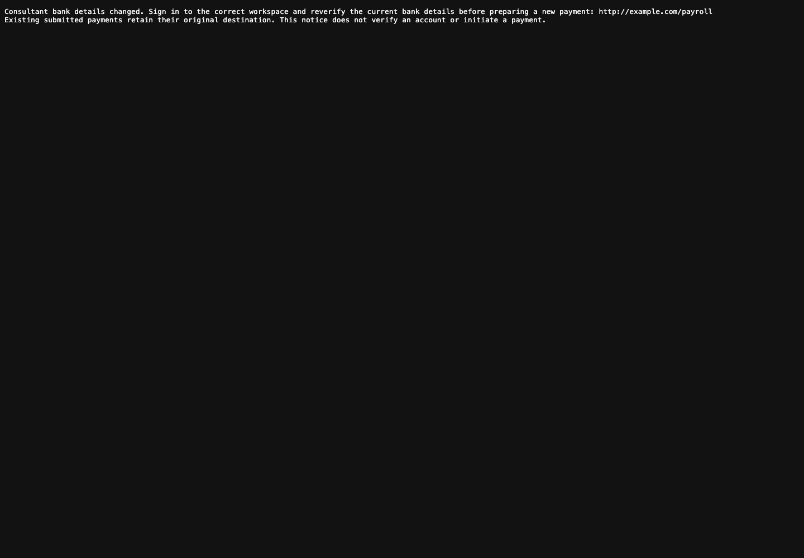
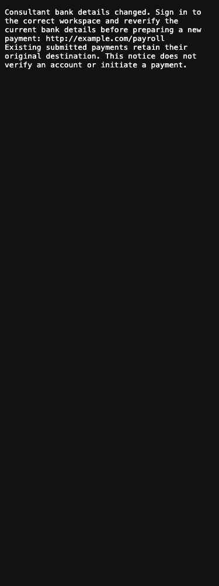
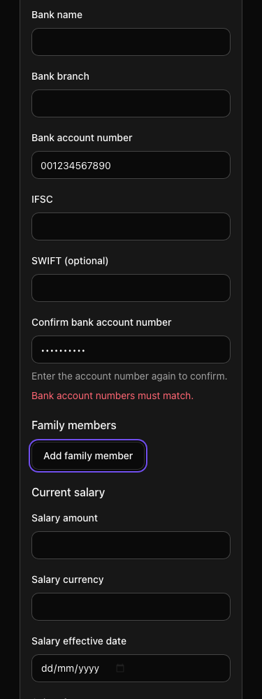

# Consultant bank-change notices

This implements the accounts-notification part of Sonam #2458 section 1, plus accessible feedback for account confirmation. It does not complete consultant billing/tax identity, all beneficiary fields, invoice generation or live provider acceptance. The compound fresh-beneficiary-verification acceptance item remains pending.

Configured consultants' meaningful bank edits create a private delivery journal in the same transaction. Active owners and explicitly assigned accounts reviewers receive a generic sign-in link, with membership/assignment checked again before sending. No bank values, consultant names or amounts enter the journal, mail or queue arguments. Submitted destinations are unchanged. Disabled delivery stays queued; attempted transport failures and interrupted sends become uncertain and are never automatically resent. Queued recovery waits fifteen minutes and runs every five minutes, allowing up to twenty minutes to recover an initial enqueue failure.

## Verification

- The new three HTTP cases and existing twenty-nine employee-record cases pass. Four existing Mercury/India changed-bank and frozen-credit cases pass. The separate issue ledger retains **38 pending** examples; they are not implemented tests.
- Twelve new journal/job examples pass on migrated and fresh schema databases. Coverage includes actual competing workers, rollback, no-op/contact/salary versus initial/clear/A→B→A, recipient/tenant boundaries, disabled delivery, uncertainty and durable recovery.
- Independent root checks also run those twelve followed by existing India delivery and PTO-notice tests: **29 examples, zero failures**. Together with the thirty-six HTTP/financial cases, this is **65 distinct executed backend examples**, not a sum of repeated migrated/fresh runs.
- Native browser checks: three account-confirmation cases and one real self-edit → committed notices → two test mails → assigned accounts Payroll/run navigation. Console errors and browser exceptions are zero. Separate positive controls proved both console and exception listeners work; control probes are excluded from product counts.
- Required development and test Vite builds pass. ESLint/RuboCop/Reek pass for changed files. TypeScript still reports the existing **329 errors**; the entire normalized error multiset matches parent `7db6a071` with no additions or removals. This is not a type-clean project.
- Migrated and fresh PostgreSQL 16 catalogs match: 305 migration versions, 10 trigger functions, 20 triggers, 563 constraints, 726 indexes and 1735 columns. Production PostgreSQL 15 and a fresh production-data rehearsal are unverified.

Browser testing first exposed an invalid accounts destination: Consultant payroll is owner/admin-only. The corrected generic `/payroll` link lets the assigned bookkeeper open their actual run without widening permissions. The failed run was retained; it is not counted as a pass. Mail screenshots show the actual plaintext body, not a proposed HTML design.

Claude Opus reviewed captured source; conditional findings caused by an incomplete first capture were resolved against full source. Its useful accessibility, recovery and message-ID feedback was addressed. Kimi's repository review timed out without a final result; a narrower CLI attempt was refused by its managed-hook path check. Local Qwen produced advisory output, but incorrect proposals were rejected. Neither unsuccessful Kimi work nor model agreement is credited as passing security coverage.

## Screenshots

All identities and account values in browser tests are synthetic. No real email, provider write, transfer, production migration, DNS or credential action was performed. Hosted CI, exact-head review gates and release deployment remain separate evidence.
