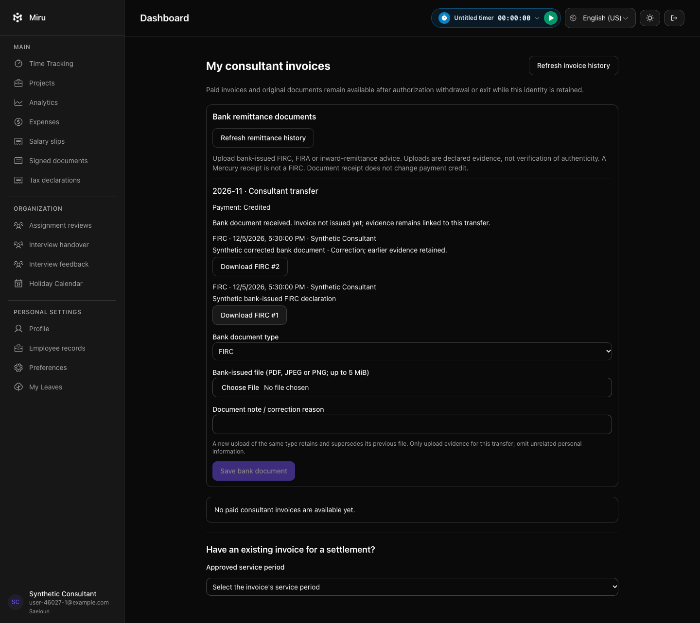
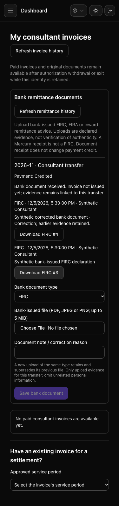

# Consultant bank remittance evidence

Synthetic local verification on 15 November 2026 for Sonam's issue #2458, section11. No production identities, bank accounts, messages or payments were used.

Six native-Brave system examples passed at desktop1440px and mobile375px, with no recorded console errors. They cover private upload before invoice issuance, retained corrections, exact-byte download, discovery from an issued invoice, immediate role/workspace revocation, preservation of another split leg's draft or pending upload, and an uncertain Mercury submission with a retained request ID. Regressions first reproduced misleading document-receipt text and the uncertain-transfer panel's404.

Payment status and document receipt are shown independently. Missing-document follow-up requires recorded credit and excludes returned, cancelled, blocked and failed transactions. Uploading a document never records bank credit or verifies its authenticity.

The private Rails test stack used a dedicated synthetic database and Disk storage, test mail/queue adapters, and an OS loopback-only network boundary. Brave used a fresh synthetic profile with its native sandbox enabled; intercepted nonlocal page requests were positively tested before navigation. This does not establish an OS-wide Brave network restriction or production verification. The invoice-discovery case used a PDF fixture; native invoice rendering is tested separately.

Screenshots show synthetic corrected evidence and its retained original:

Known limits: interrupted uploads or failed storage deletion can leave unreferenced private bytes requiring operator review. History queries are bounded but not batched. Miru does not retrieve bank certificates, send automatic follow-up, or treat a Mercury receipt as a FIRC.
