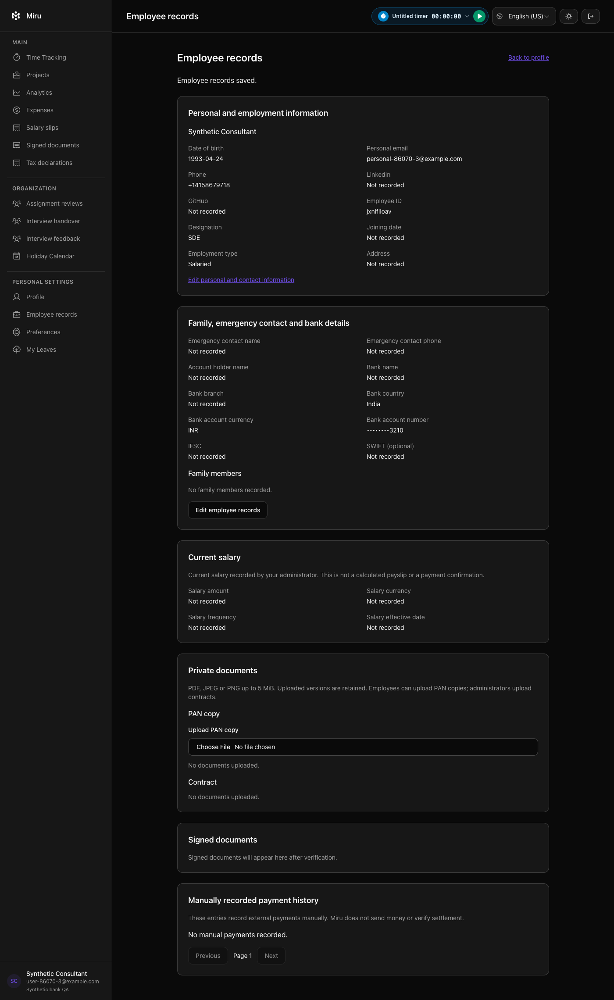
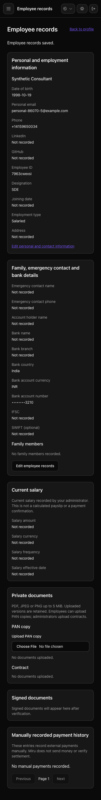

# Employee record safeguards

Local synthetic QA for issue #2461, 11 November 2026 IST. These images contain fictional records and masked bank account numbers; they are not production evidence.

Bank country uses the supported country selector. Reloading or cancelling clears the independent account-number confirmation. PAN and contract uploads wait until employee-record edits are saved or cancelled, preserving the draft. Bank/salary changes advance a protected version; stale writers cannot restore old payment instructions.

Verification:

- New backend assertions failed before implementation: 9 examples, 9 failures. The actual Brave upload case also failed because upload remained enabled during editing.
- Changed model/request specs: 45 examples, 0 failures, independently rerun after review. Adjacent bank-notice/profile-completion specs: 13 examples, 0 failures.
- Entire changed browser spec: 13 examples, 0 failures, using a fresh standalone Brave profile, a dedicated synthetic database and loopback-only application networking. Strict console-error and uncaught-exception checks passed.
- Required development Vite build, test Vite build, RuboCop, Prettier and whitespace checks passed. The review rerun of the Vite command reused the unchanged completed build.

The two additive migrations retain their existing deployed version identifiers. No production migration, account setup, email or payment operation was performed for this QA. PTO/payable-day reporting, optional salary-history UI and production reminder acceptance remain separate work.

