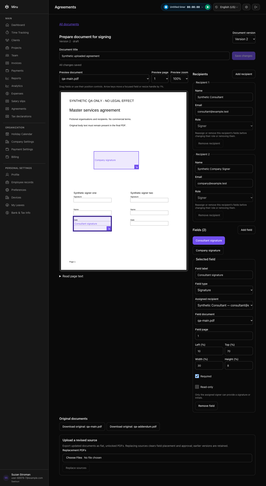
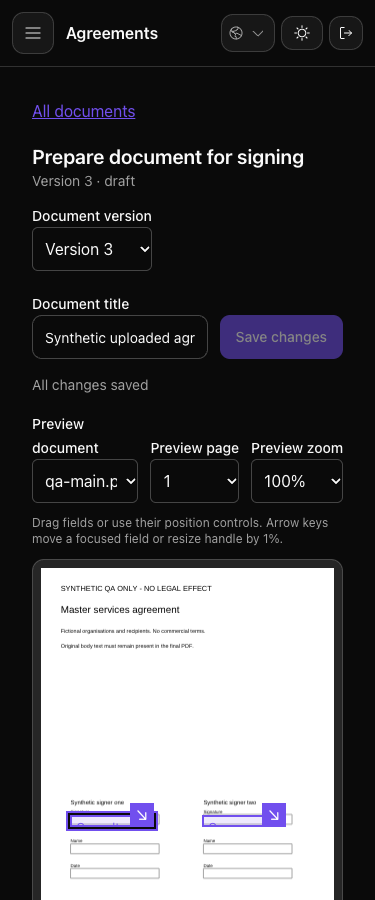
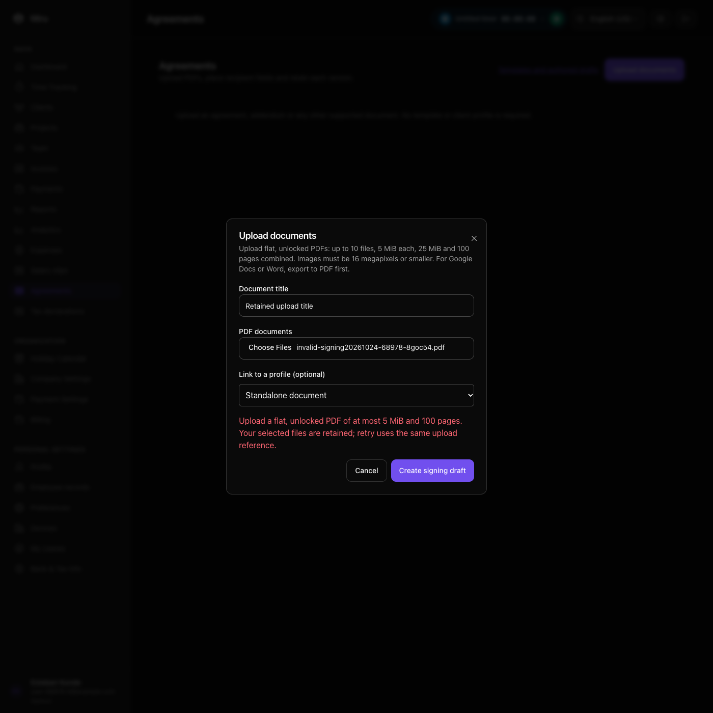
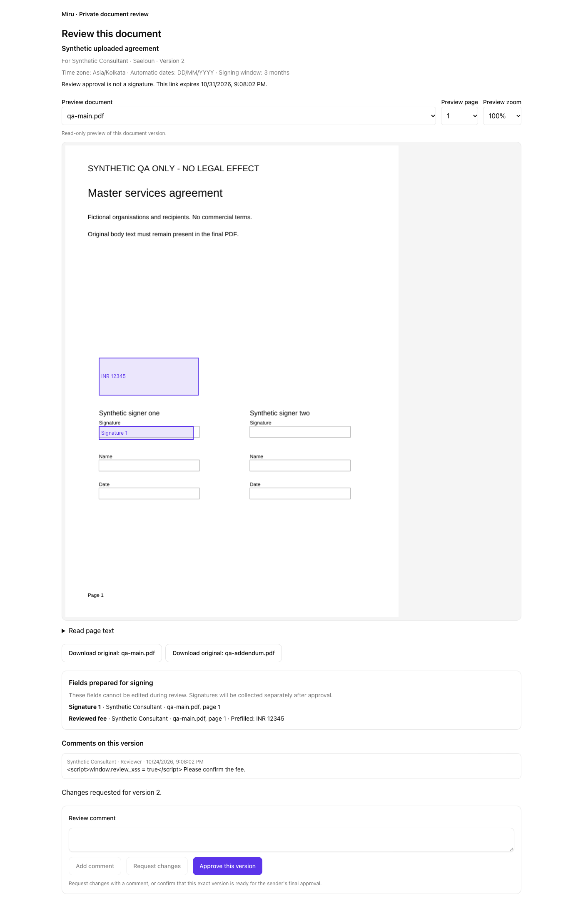
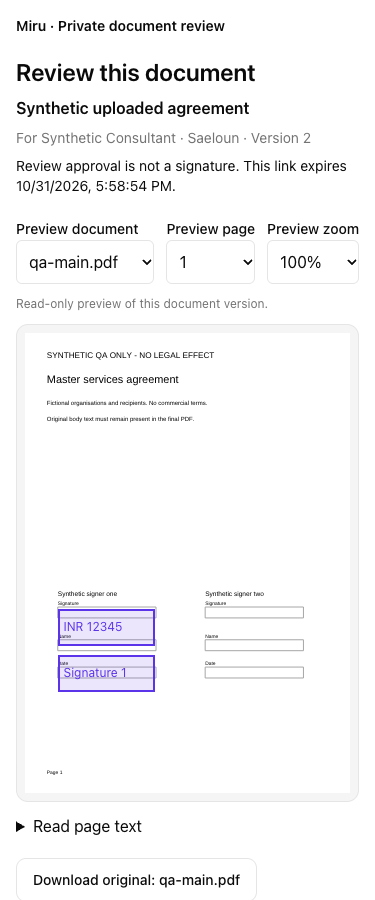
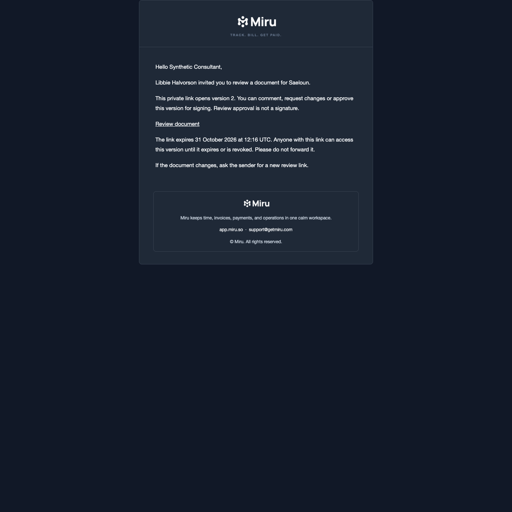
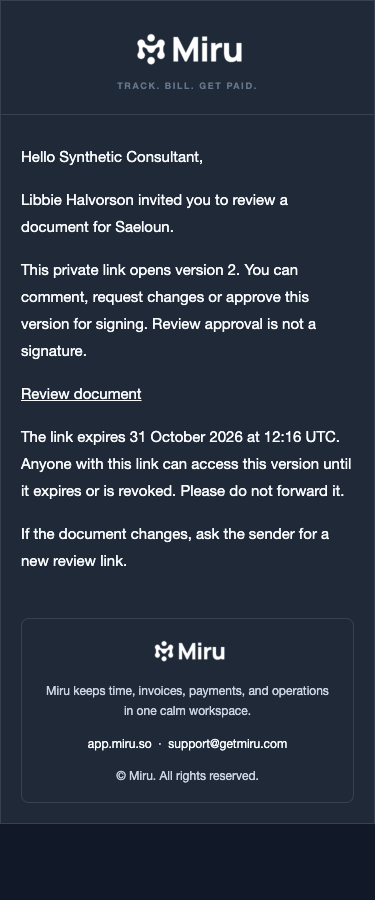
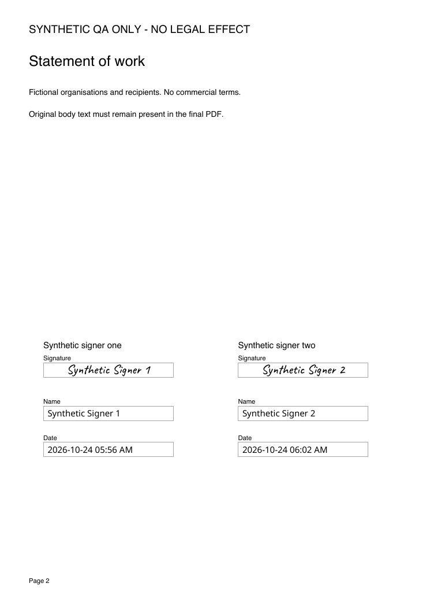
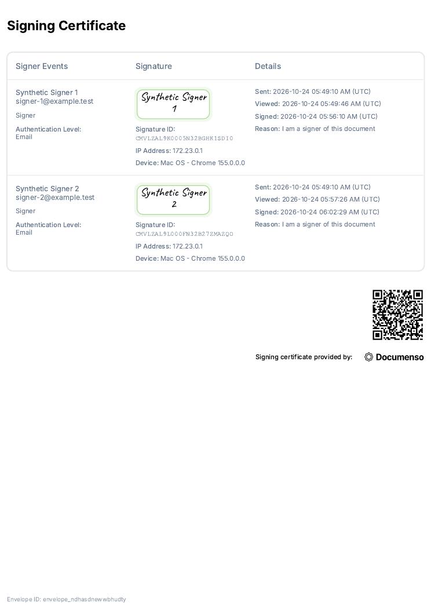

# Documenso local validation, 2026-10-24

**DONE_WITH_CONCERNS: the provider feasibility test below is complete. Miru's private upload/revision, field placement and version-bound review implementation is in progress; provider sending and completed-artifact integration are not released. PR #2475 stays a draft.** The [corrected requirements](../../superpowers/specs/2026-10-24-generic-document-signing.md) make individual uploads primary and templates optional. Existing authoring-unit CI/test counts do not verify this workflow.

## Miru upload and placement checks

The current branch makes uploaded documents primary and keeps template authoring under the secondary archive. Local checks cover private original bytes, encrypted version snapshots, stale/workspace guards, exact-digest downloads, source-replacement remapping, recipient assignments, typed fields, keyboard/pointer movement and resizing, zoom, cropped/rotated pages and locally bundled JPEG2000 decoding. Sources use the documented file/page limits and a 16-megapixel image cap.

Verification on 2026-10-24: **44 focused backend examples, nine new real-Brave journeys and 14 existing authoring checks passed**; Ruby/JS lint, Reek, required Vite builds and the Ruby4/Linux parser probe passed. The new journeys include two-signer pointer placement and resize, upload recovery and prevention of unsaved-edit loss during workspace switching. These checks cover preparation, not review approval, Documenso sending, verified completion or production deployment.

A separate manual Brave/CUA QA invocation stopped at local sign-in because its known-value readback guard could not verify the synthetic fields. That invocation is incomplete, has no health score and supplies no passing release gate. The screenshots below come from the repeatable real-Brave system tests using only fictional recipients/documents; they are actual Miru UI, unlike the provider PDF renders elsewhere in this report.

## Miru version review and approval checks

The branch adds private reviewer links, encrypted comments/replies, explicit review decisions and admin approval tied to the exact source/recipient/field digest. Editing or replacing a source creates a new version and invalidates its links and approval. Reviewer access expires or can be revoked; a decision recorded before expiry remains historical evidence. Review approval is not a signature or verified signer identity. Links grant access to their holder and must not be forwarded.

Backend verification covers scoped access, expired/revoked/reissued capabilities, immutable invitation bindings and comments, pagination, stale/incomplete approvals, readiness, CSRF, public rate limits, queue failures, delivery during source replacement and mail privacy. The invitation mailer keeps link credentials out of delivery instrumentation and job arguments. The migration passed up/down/up against the isolated test database.

The final serial gate at `ec974db0c` passed **73 examples, zero failures**, including 28 real-Brave journeys across uploaded documents and existing agreement authoring. It includes protected draft recovery, navigation after a pending autosave and preservation of unsent review comments. An earlier mixed-role fixture failure was fixed in the test login helper without changing production role rules.

An additional CLI-driven Playwright probe used the actual Brave executable and fictional data on a separate local database. The review page loaded its PDF with 17 local requests, no account API or off-site requests, no browser errors and an empty URL fragment after mounting. Original download matched the fixture byte for byte; mobile comments/change requests worked without overflow. This is a functional probe, not a formal gstack QA release gate. Local email previews were rendered in Brave at desktop/mobile widths; no real recipient email was sent.

These screenshots are actual local Miru UI with synthetic documents and recipients:

Provider connection/send/cancel/reconciliation and verified completed artifacts are the next units. No production readiness or completed Miru signature follows from these review checks.

## Miru HTTP client checks

The new server-side client uses the pinned envelope API: multipart `payload` plus repeated `files`, raw `Authorization` API key, fixed provider paths and original-item downloads. The provider origin comes only from server configuration. HTTPS is required in production; development/test HTTP is restricted to loopback. Requests have explicit connection/read/write and total time limits, disabled transport retries, bounded JSON/file responses and no redirect following. Provider bodies and credentials are excluded from public errors. A timeout, server error or malformed mutation response produces an uncertain outcome rather than permission to create or send again.

The focused client/source/configuration run passed **40 examples, zero failures**. The multipart case uses a real loopback HTTP receiver because the HTTP mock bypasses the standard library's multipart encoder. Ruby lint and Reek passed.

A second live probe used this Miru client against the same pinned local provider with two synthetic PDFs and two fictional signers. Both original downloads matched their source SHA-256 digests. Creation returned DRAFT, distribution returned PENDING, a reminder was accepted and cancellation read back as CANCELLED. `Asia/Kolkata`, `dd/MM/yyyy` and parallel signing persisted. Only local Mailpit SMTP was configured; reminder acceptance does not establish delivery to a real mailbox.

A separate contract probe confirmed that cancelling an undistributed DRAFT returns HTTP 400 and leaves it DRAFT. Miru must distinguish cancellation before distribution from cancellation of a sent request, retaining an unused provider draft without treating it as a signed artifact. The probe deleted its disposable draft and confirmed HTTP 404 afterward; this cleanup does not establish an atomic deletion guard for arbitrary provider documents.

This client probe did not exercise Miru's job orchestration or browser delivery controls. The later backend checks below cover orchestration and recovery; the complete signing journey and production remain held.

## Company credential API checks

The company-scoped connection API verifies a key using a bounded, read-only provider request before activation. Keys are encrypted and excluded from model inspection, request logs and API responses. Reconnecting creates a new credential version; old versions retain their original server binding so existing requests can use their original account. A server-origin change prevents an old key from being sent to the replacement host. New requests select the current connection and bind that immutable credential version when queued.

The serial backend gate passed **96 examples, zero failures**, including 12 connection requests and 15 HTTP-client cases. Connection coverage includes stale rotation, cross-company IDs, employee/resigned-admin denial, CSRF, malformed/rejected credentials, membership revocation and workspace changes during provider validation. The additive migration passed up/down/up on the isolated test database. Ruby lint and Reek passed. The real provider probe also passed the new credential check before its two-document send/remind/cancel sequence. These are backend checks; no connection UI or complete signing journey is claimed.

## Approved envelope checks

Each saved version now records encrypted signing settings in its content digest: the company time zone, automatic date format, parallel delivery, signature methods, signing window and protocol version. Changing the company time zone leaves earlier versions intact. Older packages without these settings require a new version before approval; the editor provides that recovery. Private and external reviewers see the recorded settings. Literal prefilled name/email/date fields preserve their exact text; blank fields use native automatic values. Preparation help explains this distinction and is associated with the value input for assistive technology.

Field positions are canonicalized to 0.01% in the editor and saved revision before review. Sending cannot silently move an approved field, and provider readback must match the exact saved decimal positions. Regression cases include subpixel provider edits, drag/resize persistence and HTML validation at the page edge. Saving a new version requires confirmation before discarding unsent review comments or approval evidence.

The envelope verifier checks the operation reference, title, source order/digests, recipient identity/role/authentication, field assignment/type/value/geometry and signing settings. A live local probe passed with **two PDFs, four recipient roles and 13 fields**, covering all nine native field types plus three literal prefills. It verified DRAFT and PENDING originals/configuration and read back CANCELLED after cancellation. The provider marks copy recipients SIGNED/SENT even in DRAFT; those defaults do not establish signer completion or email delivery. Parallel recipients are assigned explicit equal order.

The preparation/preview serial gate passed **150 examples, zero failures**, including **32 real-Brave browser cases** across uploaded documents and existing authoring. The options migration passed up/down/up on the isolated database; required Vite builds, changed Ruby/JS lint and Reek passed. Two earlier screenshot journeys passed with aligned synthetic fields and explicit waits for rendering; all four desktop/mobile captures were byte-checked and visually inspected. These checks cover preparation, approval and the provider payload boundary. Browser delivery controls, configurable stronger authentication, profile archives, verified completion and production release remain outstanding. Physical alignment in completed cropped/rotated PDFs still needs verification.

Five small PDF cases reproduced missing limits on page area, page sides, hidden/inherited MediaBox geometry and UserUnit scaling. They are now rejected before preview or provider upload. Ordinary inherited, cropped, rotated, scaled and tall pages remain supported within the documented bounds. A real Brave test first observed a 13,200-pixel-tall preview canvas; it now checks a maximum of 4,000 pixels per canvas side at 100% and 200% zoom, with unchanged CSS field coordinates and no console errors. This bounds the page canvas allocation, not total browser or PDF-decoder memory.

## Durable delivery backend

Company-scoped admin actions now queue send, cancel, reminder and status-check operations. Sending requires the current approved digest, complete validated fields, a usable company connection and active admin membership. Jobs recheck authority before provider mutations, use the version's original credential binding and persist the provider ID before distribution. Originals are read privately, digest-checked and parsed again before creation. Job arguments contain only an operation ID; responses and audit events exclude credentials, worker tokens and signing links.

Duplicate and in-progress jobs cannot repeat mutations. Interrupted preparation can be queued again; a verified provider draft can resume at verification using its existing ID. An ambiguous create requires a matching provider ID and full source/configuration verification. An ambiguous distribution is never repeated just because a later read still reports DRAFT. Cancellation before distribution retains the unused draft; cancellation during distribution waits for authoritative pending state and then continues. Provider terminal states and recorded recipient actions cannot regress. A provider COMPLETED status alone still does not make a signed archive available.

Manual reminder requests have a 24-hour cooldown. Up to three automatic reminder attempts run three days apart for pending actionable recipients, excluding copy recipients and people who already acted. Cancellation, terminal state, uncertain reminder outcome or loss of the sender's admin access stops automatic reminders. The installed Solid Queue parser accepted the reminder job and hourly schedule in both test and production configuration; that does not establish a running production scheduler. Queue failures and stopped reminders retain metadata-only audit events.

The final serial gate passed **180 examples, zero failures**, including **32 real-Brave browser cases**, 23 delivery service cases and seven delivery API cases. Coverage includes in-progress duplicates, membership revocation, unrelated workspace changes, missing/stale approvals, credential rotation, changed origins, queue failure/late queue responses, worker crashes before creation and after ID persistence, ambiguous creation/distribution/cancellation, cancellation races, changed provider data, state regressions, cooldowns and bounded automatic reminders. Both migrations passed up/down/up; changed Ruby lint, Reek and the required Vite build passed. This remains backend delivery coverage; the existing browser cases cover preparation and review rather than the unfinished send controls.

The [actual Miru job probe](miru-delivery-results.json) used the pinned local provider with two PDFs, three pages, four recipients and six signature fields. Running each operation twice produced exactly one create, distribution, reminder and cancellation. Every operation confirmed, and the final authoritative status was CANCELLED. The provider image digest and internal-only Docker network were checked again. This used only fictional recipients and local SMTP; no human signing, external mailbox delivery or production change is claimed. Normal API-key creation through the provider UI and stronger signer authentication remain unverified.

## Environment and isolation

Live local self-hosted Documenso **2.21.1**, Node 24.22.1, Linux arm64 on Docker 29.5.2. Image pinned to `ghcr.io/documenso/documenso@sha256:41a69062febc915d1508b87be8c5bbe72ecd3c49232ddcd983490f5f7832f053`. PostgreSQL 15, local Mailpit SMTP capture, internal Docker network, localhost-only proxy on ports 3318/3319. No licence key, subscription, production credentials, real contract or external SMTP delivery. The certificate was disposable, self-signed and explicitly named Synthetic QA ONLY.

The account was created through the normal UI and verified using its locally captured email. API probes used a disposable fixture token seeded with the provider's hash algorithm; no licence claims or plan flags were overridden. Token-management and creation dialogs opened without a paywall, but browser control disconnected before completing token creation through the UI. That final UI operation remains unverified.

All documents and recipients are fictional. The user's Google Doc supplied only the structural case: main agreement plus SOW, each with two party signature blocks. Its actual content and identities were not copied. Probe scripts/results and the local audit export are retained under `/tmp/miru-documenso-validation-20261024`; local environment files and recipient links are excluded from this repository. The stack is disposable; its persistent database is retained when stopping containers.

## Observed checks

| Check | Result |
| --- | --- |
| One-off `DOCUMENT` upload, without a template | HTTP 200; two PDFs, three source pages, two signers, 19 positioned signature/name/date/text fields; `templateId` null |
| Anonymous / invalid API token | Both HTTP 401 |
| Invalid bytes uploaded as PDF | HTTP 400 |
| Required text left empty in signing UI | Submission blocked with "Text is required" |
| Different recipients and repeated blocks | Fictional signers independently completed the main agreement, SOW and addendum in Brave |
| First signer completes | Envelope stays PENDING; SIGNED / NOT_SIGNED retained separately |
| Both signers complete | Envelope COMPLETED; both recipients SIGNED with separate timestamps |
| Completion notifications | Exactly one "Signing Complete!" message for each signer and the owner in local Mailpit |
| Original downloads | Both byte-identical to uploaded PDFs |
| Completed artifacts | Two sealed PDFs, one completion certificate, seven-page audit PDF downloaded; source text, SOW and required QA text retained |
| Independent PDF verification | Poppler `pdfsig`: SHA-256, ETSI.CAdES.detached, total document signed, Signature is Valid for both PDFs |
| Tamper detection | Changing a PDF header byte in a separate copy produces Digest Mismatch |
| Completed field edit | HTTP 400 "Envelope already complete"; field position and sealed PDF bytes unchanged |
| Pending cancellation | HTTP 200, authoritative CANCELLED state; no email distribution for this boundary case |
| Persistence | Restarted Postgres and recreated the app container; COMPLETED, both signer statuses and byte-identical sealed PDFs survived |
| Browser result | "Document Signed / Everyone has signed" visible after restart; no errors in captured console checks |

The PDFs were text-extracted and visually rendered. Main output has three pages (two source pages plus signing certificate); addendum has two (one source page plus certificate). Both signatures fit the intended blocks. The separate certificate has one page; a Type 3 glyph bounding-box warning from Poppler did not prevent rendering or legibility. `pdfsig` also emitted a local missing-Firefox-folder diagnostic; its signature results above are explicit. The self-signed certificate issuer is **not trusted**: the test proves integrity, not a publicly trusted identity or jurisdiction-specific legal compliance. Individual recipient identity/consent is represented by the provider's audit evidence; the PDF cryptographic seal belongs to the test service certificate.

## Integration gaps reproduced

| Boundary | Actual behavior | Required Miru guard |
| --- | --- | --- |
| Page does not exist | API stored page 99 against a two-page PDF, HTTP 200 | Check every field against the canonical PDF's actual pages |
| Rectangle exceeds page | API stored x=95%, width=30%, HTTP 200 | Validate the whole rectangle with page rotation/size, including x+width and y+height |
| Sent version lock | Field x changed from 10 to 11 while PENDING, HTTP 200; persisted on readback | Lock Miru's sent revision and recipient/field definitions; bind requests to immutable snapshots. This case had no completed recipient; post-partial-signing edits were not tested |
| Download is not proof of completion | Explicit `version=signed` returned HTTP 200 with the unsigned original while PENDING; byte-identical to `version=original`, no PDF signature | Require authoritative completion, signer states and the expected sealed artifact before publishing a signed download |

Documenso's [webhook verification contract](https://docs.documenso.com/docs/developers/webhooks/verification) sends a shared header secret. It is not a per-body HMAC. Miru must reject empty/missing configuration, use a constant-time comparison, deduplicate/reconcile events and fetch authoritative company-bound state. No webhook delivery/replay test was run here.

The [embedded editor is paid](https://docs.documenso.com/docs/developers/embedding/editor). This candidate requires Miru's own upload/placement screen; no paid embedding was activated or bypassed. [Community licence obligations](https://docs.documenso.com/docs/policies/licenses), hosting, durable keys, email and backups still need deployment assessment.

## Evidence

- Original synthetic inputs: [main agreement and SOW](qa-main.pdf), [addendum](qa-addendum.pdf).
- Completed outputs: [main agreement and SOW](signed-qa-main.pdf), [addendum](signed-qa-addendum.pdf), [certificate](completion-certificate.pdf).
- Rendered output pages below are actual provider PDFs, not a Miru UI mockup.

## Coverage limits

The original feasibility probe preceded the Miru implementation checks described above. Its observations were collected before a formal gstack wrapper was opened; no retrospective charter or clean QA gate is claimed. Production/staging, provider concurrency, stronger recipient authentication, webhook retries/reordering, backup restore, DOCX conversion, screen-reader operation and large-document/load performance remain unverified. The original probe defaulted to UTC; the new envelope explicitly records and verifies the intended timezone. Reminder acceptance and expiry metadata have been checked, but timed reminder/expiry execution has not. A single two-file create took 0.179s; that is not a UI, load or production benchmark.

Next: bound page rendering, connect approved packages to durable send/cancel/reminder/reconciliation jobs and verify the entire Miru-to-signed-archive flow. Keep #2462 and the production hold open until that workflow and the release gates pass.
