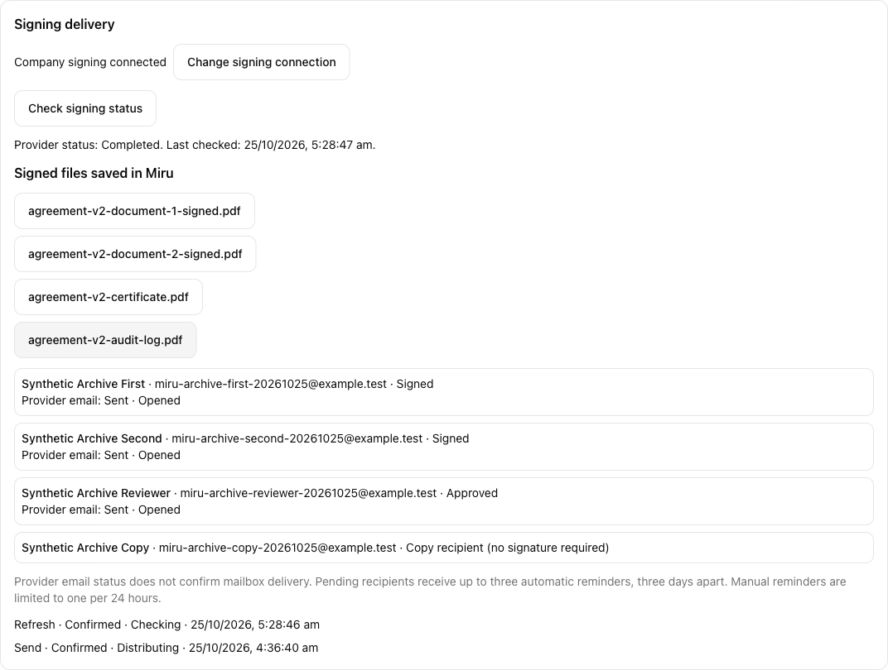
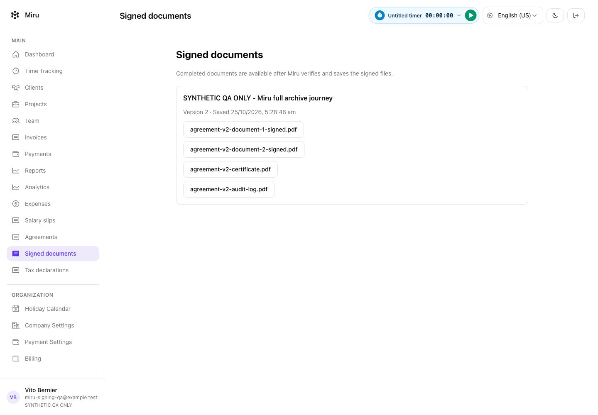
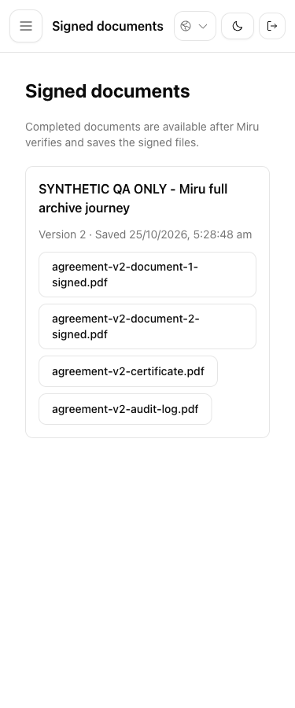
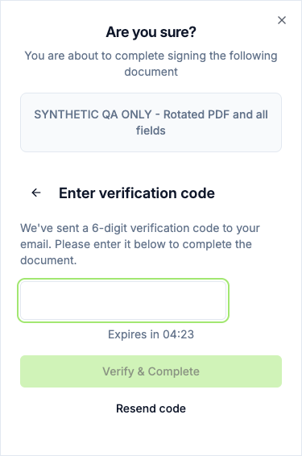
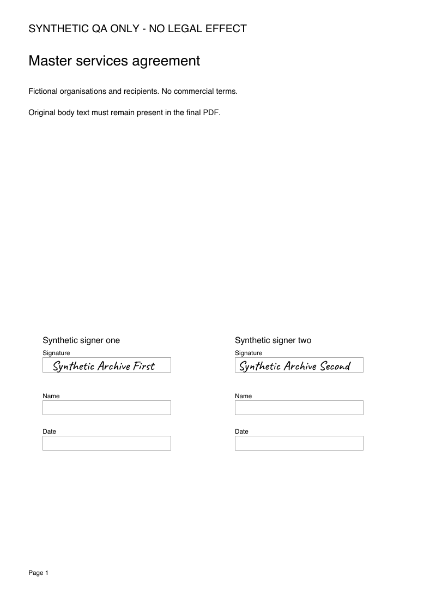
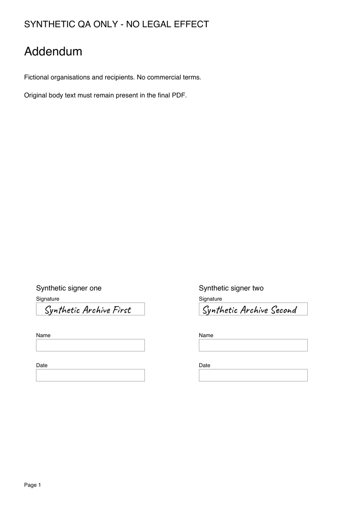
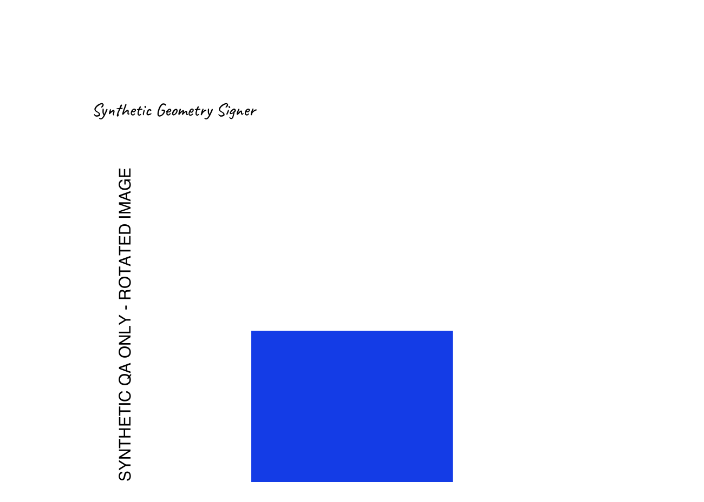
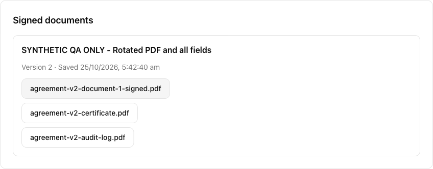

# Actual signing and archive checks

Local synthetic QA on 25 October 2026. Miru runtime `7678d9818b40f2d98dd8edbf440c3da52649ae6b`; final provider image `sha256:4be09d51a2ae0a4462f4a7dc1f593475cc797ae089705134caaa6199acabb7c9`. Brave, a separate Miru database, persistent Solid Queue worker, local Documenso/PostgreSQL and Mailpit were used. Every recipient and document is fictional; no external signature email was sent.

## Completed flows

| Case | Observed result |
| --- | --- |
| Main agreement, SOW and addendum | Two PDFs, three source pages, six signature fields, two signers, one reviewer and CC. Separate anonymous sessions completed the three actionable recipients with their own email codes. |
| Partial completion | After each signer completed, provider status remained PENDING and Miru exposed no archive. The pre-completion download returned 404. CC status carried no signature requirement. |
| Verification and recovery | The first automatic final sync rejected a legitimate eight-page audit whose font dictionaries produced 1.8 MiB of qpdf JSON. A regression reproduced it. A bounded 4 MiB allowance fixed it; CPU, time, memory and other output limits remain. The normal status button then queued real worker jobs and saved all four files before marking Signed. |
| Fresh automatic completion | A second request used cropped pages rotated 90°/270°, all nine field types, another signature on page two, and read-only Unicode text. All eleven fields completed; the actual final callback and worker archived three files automatically. All five callbacks were processed and no queue job failed. |
| Field values | Date `25/10/2026` with Asia/Kolkata and `dd/MM/yyyy`; name, email, initials, `1234.50`, selected checkbox, dropdown, ₹ text and Marathi text survived provider readback and final PDF text extraction. |
| Read-only protection | A valid direct field-change request received 400 with the provider's read-only error. The original value remained unchanged. Earlier malformed probe requests were excluded from this check. |
| Callback authentication/replay | Missing credential returned 401. Sending the same constructed, correctly bound event twice returned 202/202 with one additional worker job. The archive retained the same keys/hashes, four attachments and one creation audit. |
| Actual downloads | Seven editor download buttons and the linked consultant-profile button produced files with the exact archived SHA-256 hashes. Native PDF checks passed on eleven retained provider/UI artifacts, including full-file service seals on every signed PDF. |

The first signing flow rejected missing/wrong codes with 401 and accepted the correct code with 200. Its original code widget emitted a CSP error. The final source-built image uses the existing ordinary input, keeps six-digit validation and autocomplete, and completed the second flow's mobile code screen with zero CSP or browser errors. Its empty-code submission stayed disabled.

The first native Brave signing attempt also exposed canvas hit detection failing under privacy-protected pixel reads. The [current upstream-source patch](documenso-signing-compatibility.patch) adds named DOM controls that reuse the provider's field handlers, supports keyboard activation, labels the signature editor, fixes duration formatting and removes the problematic code widget. No browser privacy setting, licence flag, paid plan or CSP rule was changed.

The patch applies to [Documenso source `8707e33`](https://github.com/documenso/documenso/tree/8707e33c124e4b1a68dde92d5e05178c9aabd0be). It includes the earlier countdown change; use this composite patch for the current build. `git apply --check --cached` passed against that clean index, and the complete source image build, including TypeScript checks, passed. Preserve the upstream [licence](https://github.com/documenso/documenso/blob/8707e33c124e4b1a68dde92d5e05178c9aabd0be/LICENSE) and package notices with the source.

Focused validation: **45 PDF/seal/reconciliation examples, zero failures**, then **four real-Brave archive cases, zero failures**. The latter wait for usable card width after viewport resizing. An immediate unsettled mobile capture was excluded and replaced by the settled capture below. Miru's actual download/recovery/profile checks recorded zero browser errors. Expected negative HTTP responses are retained separately from unexpected errors.

## Inspected evidence

## Remaining release checks

Rejection/expiry handling, final branch review, CodeRabbit, exact-head CI and private release integration remain. Production HTTPS, provider certificate/storage/SMTP, backup/restore and deployment have not been verified. The certificate used here is a disposable self-signed QA service seal. These checks establish this local workflow and file integrity; they do not establish production operation or public/legal certificate trust.
