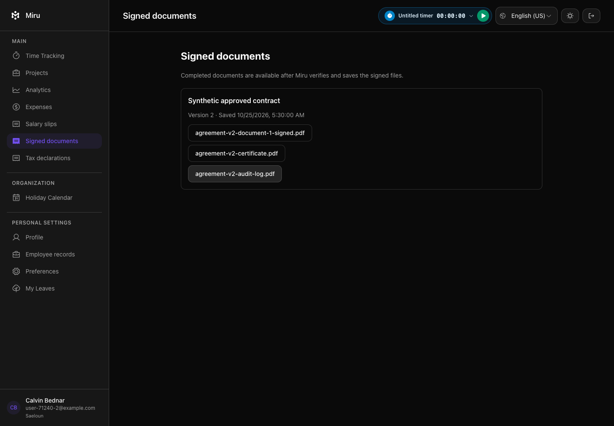
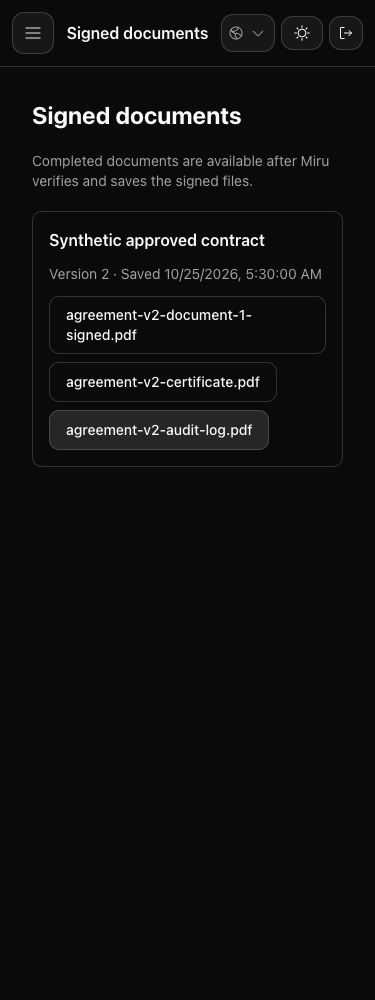
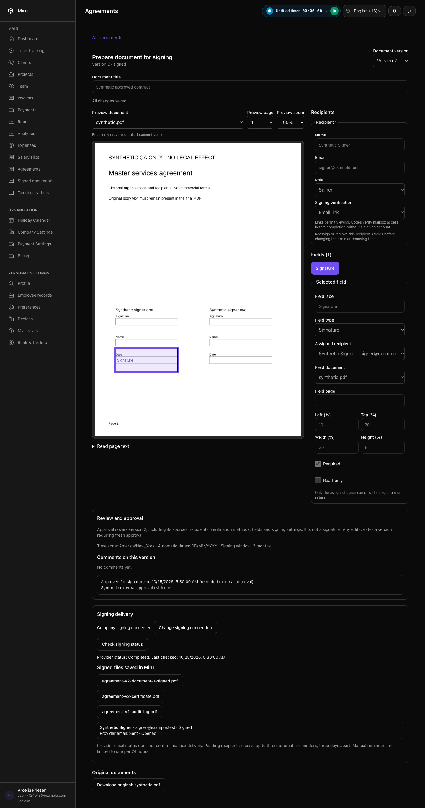
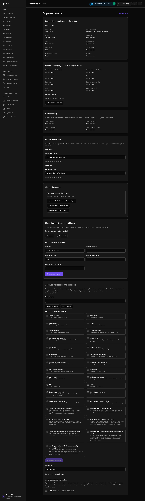
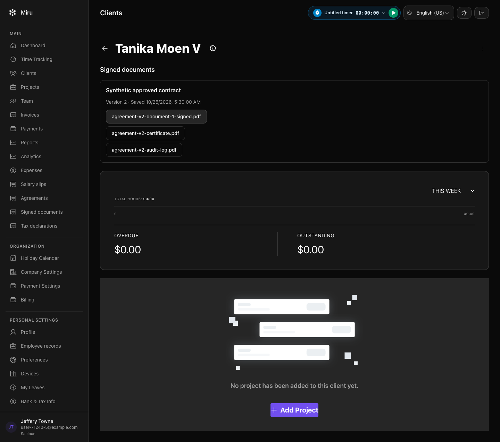

# Signed archive and download checks — October 25, 2026

The related suite passed 280 examples with no failures. After improving filename wrapping and screenshot capture, the four archive browser journeys passed again. Normal/test Vite builds, Ruby/JavaScript lint and Reek passed. The migration passed up/down/up in the isolated test database.

These are actual Miru screens from real-Brave regression tests with fictional companies, users and documents. Provider API responses are stubbed; the sealed PDF fixture came from the owned local Documenso instance. The tests download and hash-check all three artifact types at desktop/mobile widths, verify both profile links, retain the editor lock and show archival failures without offering signed downloads. Request/service checks cover authorization, damaged bytes, callbacks, retries and races.

This evidence does not establish the remaining complete Miru→Documenso→Miru signing journey, production deployment, publicly trusted signer identity or legal suitability for every document type.

## Employee archive

## Locked signing request

## Profile archives

