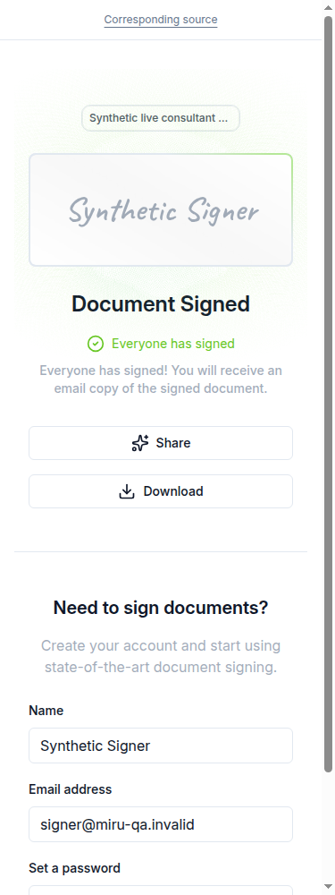
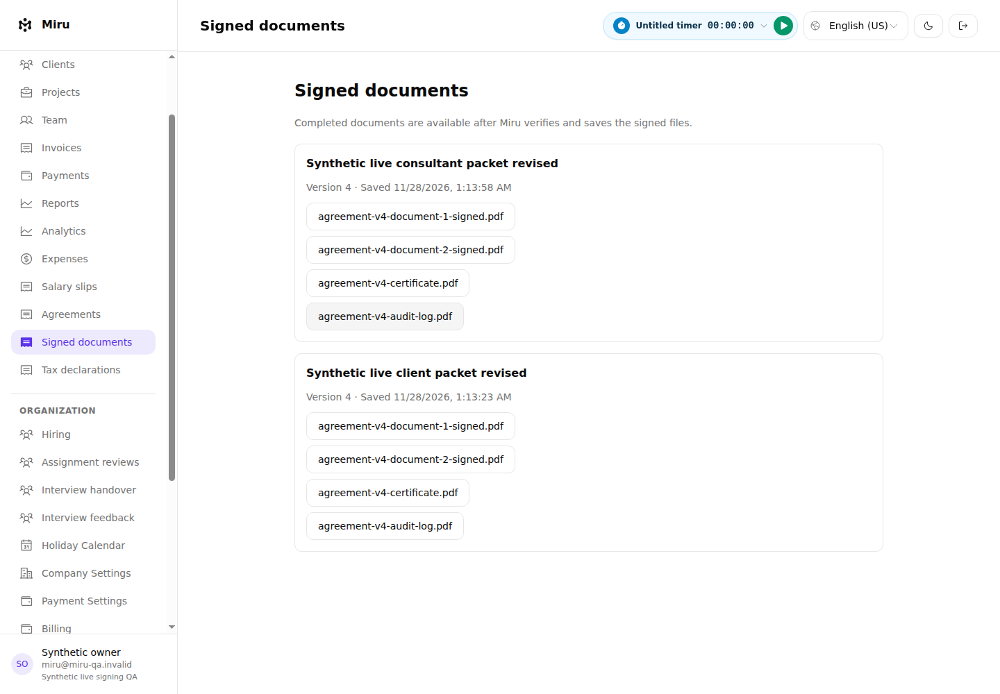

# Security candidate: retained signing qualification

The [functional run](https://github.com/saeloun/miru-web/actions/runs/46091419465) completed both client and consultant lifecycles against provider source `9b2b3c48a5a129243ad2189776f6352ba522c1bc`, image config `42355ef1aea7b1570594029bd5197dd0cebdfc03194030d0a7b967146de8303e`, and unchanged Miru application `4aa6ff5744267b1942bbf614fac322c8c1184bf7`. The tested fixture is `73a707aa6d144fc3e8103d4893c5131632582367`; this gallery is an evidence-only descendant, not another runtime test.

The exact image passed independent archive/config/all 23 rootfs layer verification and a fresh official-DB vulnerability scan with zero findings across all severities. The database was updated November 27 at 19:05:47 UTC and freshly downloaded November 28 at 00:48:00 UTC. This is a dated image/database result, not universal security.

Both packets reached version 4 with two documents, ten fields and two signers. Receipts show four recipient completion acknowledgements, 16 native PDF downloads across desktop/mobile, valid signed-PDF seals and preserved bodies, certificate/audit identity binding, 32 denial requests across all four actors with no PDF bytes, three source assets, zero console errors and complete cleanup without errors or evidence rejection. The consultant performed the actual mobile signing controls at 375px; completed-page captures alone are not that proof.

Current private Miru release candidate interoperability, production host qualification, full document-viewer visual acceptance, active source alias/provider pin changes and production activation are **not qualified** here. Existing documentation audit budgets and follow-up issues remain unchanged. Nothing is merged or deployed by publishing this evidence.

## Primary completed and archive frames

All eight frames below were individually viewed. These show completed signing and the saved four-file archives, with no loading placeholders. Native PDF bytes, seals, identities and denial outcomes come from the separate receipts, not from a screenshot alone.

| Evidence | Desktop | Mobile |
| --- | --- | --- |
| Client completed: Document Signed, Everyone has signed | [1440px](images/signed-client-1440.png) | [375px](images/signed-client-375.png) |
| Consultant completed: Document Signed, Everyone has signed | [1440px](images/signed-consultant-1440.png) | [375px](images/signed-consultant-375.png) |
| Client archive: version 4 and four artifact links | [1440px](images/archive-client-1440.png) | [375px](images/archive-client-375.png) |
| Consultant and client archives | [1440px](images/archive-consultant-1440.png) | [375px](images/archive-consultant-375.png) |

## Context frames

These eight individually viewed frames document placement and source-notice context, not a general visual signoff. Mobile placement still has a compact document preview and truncated field labels. The empty Documents and deliberate 404 pages are expected source-notice states.

| Context | Desktop | Mobile |
| --- | --- | --- |
| Client field placement | [1440px](images/placement-client-1440.png) | [375px](images/placement-client-375.png) |
| Consultant field placement | [1440px](images/placement-consultant-1440.png) | [375px](images/placement-consultant-375.png) |
| Authenticated source notice | [1440px](images/source-auth-1440.png) | [375px](images/source-auth-375.png) |
| Source notice on deliberate 404 | [1440px](images/source-error-1440.png) | [375px](images/source-error-375.png) |

## Known Share caption defect

The actual built Share endpoint returned and rendered both 1200×630 PNGs. Both still say **“Document Sent!” after completion**. These two images are defect evidence, not approval of that caption or complete Share semantics. Both have SHA256 `0ccb1f4d89b1251f05e5d8adf73826f73858f975c92193462a975734519b3a49`; the caption limitation remains tracked in [the signing follow-up](https://github.com/saeloun/miru-web/issues/2538).

[Client Share PNG](images/share-client.png) · [Consultant Share PNG](images/share-consultant.png)

## Retained, excluded captures and durable receipts

All 28 original PNGs were individually viewed and retained unchanged with the original artifact. Ten are omitted from this qualified gallery: eight signing/embed captures with PDF loading spinners and two public signup/source-notice-only captures. They do not establish settled document/signup visual rendering. Their original names, hashes, dimensions and explicit exclusion reasons remain in [the full frame index](frames.json). Capture readiness, link bootstrap, compact placement and caption debt remain visible follow-ups; no blank/loading frame is presented here as visual success. See [review initialization](https://github.com/saeloun/miru-web/issues/2554) and [capture readiness](https://github.com/saeloun/miru-web/issues/2555).

The 18 published PNGs are byte-identical to the retained artifact, contain only synthetic or public upstream content, and passed the existing PNG chunk allowlist with no text or EXIF metadata. No customer data, credentials, review/signing tokens or private profile was observed. The QA embed scaffold is separate from Miru's actual email-based provider delivery.

- [Exact image, source, fixture and artifact binding](binding.json)
- [Sanitized runtime summary and all native PDF/denial records](receipts/summary.json)
- [Rootfs/import/network and cleanup receipt](receipts/lifecycle.json)
- [Sanitized lifecycle events](receipts/safe-events.jsonl)
- [Dated scan summary and fixed target inventory](scan-summary.json)
- [All gallery file checksums](SHA256SUMS)

The old frozen baseline and its previously published images remain intact. This new candidate result does not certify a different Miru application, a serving host, an active production source endpoint or a final release.
