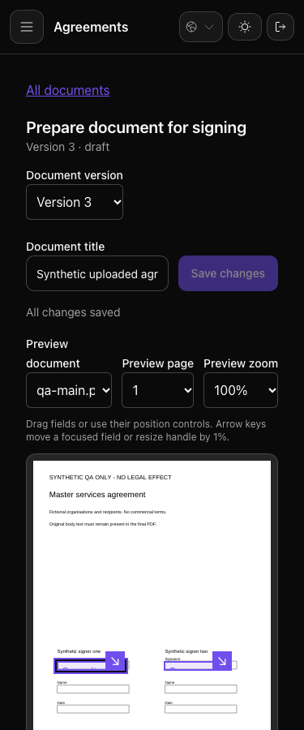
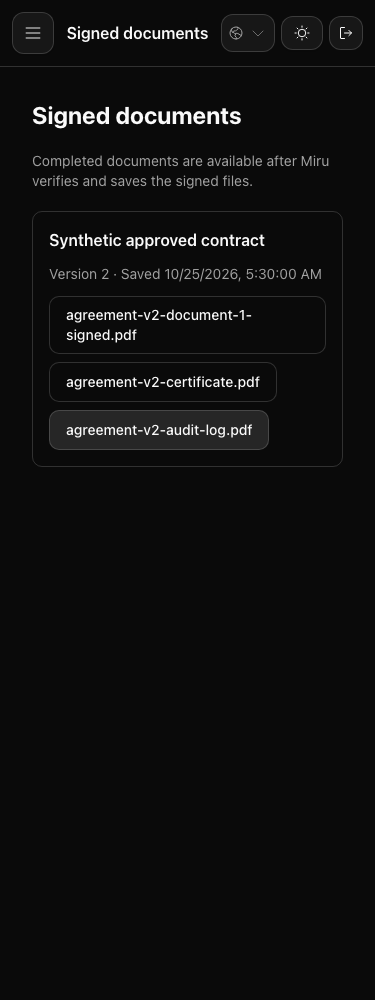

# Documenso verification, 7 November 2026

**Scoped QA passed; production remains unverified.** No application code changed.
Inputs: Miru `fb5d271d7d6d661de104e494e1a19ac878707108`, branch
`feature/sonam-release-integration-20261104`, preserved patched Documenso image
`sha256:9309cef4bf702348b3bcc96b4e1625e9d2312f4e87cf546847f7d41602994306`.
The later documentation/evidence commit does not change those tested inputs.

The old provider image, stopped containers and database survived, but their `/tmp`
Compose configuration, proxy configuration and certificate were missing. A fresh
project and database were created; the old database was neither restored nor modified.

| Contract | Result | Evidence |
| --- | --- | --- |
| Real Miru client and envelope verification | Connected; uploaded two PDFs/three pages; all nine field types and ten fields accepted; original bytes matched both SHA-256 hashes | [Live observation](verification-20261107/observation-001.json) |
| Real delivery and cancellation | Draft → Pending → Cancelled; both fictional signers received email in Mailpit; invalid API token rejected | Same live observation |
| Signing services, authorization, approval, archives and callbacks | 187 native examples, zero failures | [Focused specs](verification-20261107/observation-002.json) |
| Rendered Miru upload, placement, review, delivery and archive downloads | 31 native Brave scenarios, zero failures; existing console checks and downloaded-file hash assertions passed | [Browser specs](verification-20261107/observation-003.json) |
| Durable provider state and isolation | One envelope, cancelled; zero remaining API tokens; no nondefault claim flags; internal services isolated; published bindings loopback-only | [Final state](verification-20261107/observation-004.json) |

The live check called the existing `Signatures::DocumensoClient` and
`Signatures::Envelope` from a native Rails runner. It used the same synthetic source
PDFs and configuration shape as `spec/services/signatures/envelope_spec.rb`.
The account was created through the ordinary signup endpoint. Its temporary API token
was a **database fixture**, hashed with the provider's SHA-512 algorithm and removed
in `ensure`-equivalent cleanup. Normal token onboarding was not repeated. No license
or subscription flags were changed.

The browser cases use provider doubles and retained signed fixtures. They verify
Miru's UI and private-download handling, not fresh provider signing. Some fixture
screenshots intentionally show 25 October because the archive specs fix the clock.
Fresh signing completion, service-seal verification and completion callbacks were
not repeated here; [the earlier real completion report](actual-signing-and-archive.md)
retains its original revision and scope.

## Execution and evidence

Native commands were `bundle exec rspec spec/services/signatures` plus the five
`spec/requests/api/v1/signature_*_spec.rb` files and
`spec/requests/webhooks/documenso_controller_spec.rb`; browser commands selected
`document_signatures_spec.rb`, `signature_delivery_spec.rb` and
`signature_archives_spec.rb` under `spec/system/responsive`. Both ran through
`rtk proxy mise exec --`, with localhost-only outbound sandboxing, separate existing
test databases and `SKIP_VITE_TEST_BUILD=1`. No frontend input changed. The browser
used the installed Brave executable through Ferrum on local port 3130.

All four guarded captures exited zero, with about 138 seconds of combined probe
time. Exact commands, decoded observations and limits are retained in
[the generated evidence](verification-20261107/evidence.json). The original local
capture root is `.gstack/tmp/qa-reports/run-20261107T084140Z`; its raw stderr remains
local. Expected CSRF-negative cases logged `InvalidAuthenticityToken`; Rack also
reported the existing deprecated status-symbol warnings.

- [Checkpoint 002](verification-20261107/exploration-002.json): live provider success → native signing regressions.
- [Checkpoint 003](verification-20261107/exploration-003.json): focused regressions → native Brave scenarios.
- [Checkpoint 004](verification-20261107/exploration-004.json): browser results → durable-state and isolation assertions.

There was no reproduced application defect and no new permanent test. Existing
coverage supplied the narrower checks. Local Qwen provided advisory suggestions;
only independently checked isolation ideas were used. Its guessed table names and
destructive reset suggestions were not followed. This was not a council review.

## Screenshots

Sixteen fresh screenshots were copied without modification and checked against
[their SHA-256 manifest](verification-20261107/screenshots-sha256.json). The mobile
placement and mobile archive images below were also opened for visual inspection;
the other captures have automated test coverage, not an independent visual review.

Other captures: [desktop placement](verification-20261107/signature-placement-desktop.png),
[desktop review](verification-20261107/signature-review-desktop.png),
[mobile review](verification-20261107/signature-review-mobile.png),
[desktop review email](verification-20261107/signature-review-email-desktop.png),
[mobile review email](verification-20261107/signature-review-email-mobile.png),
[desktop authentication](verification-20261107/signature-authentication-1440.png),
[mobile authentication](verification-20261107/signature-authentication-375.png),
[upload recovery](verification-20261107/signature-upload-recovery.png),
[desktop archive](verification-20261107/signed-documents-1440.png),
[employee archive](verification-20261107/employee-signed-documents.png),
[client archive](verification-20261107/client-signed-documents.png),
[editor downloads](verification-20261107/signed-editor-downloads.png),
[desktop rejected short artifact](verification-20261107/short-signed-document-rejected-1440.png),
[mobile rejected short artifact](verification-20261107/short-signed-document-rejected-375.png).

## Isolation, cleanup and release limits

The fresh provider, PostgreSQL and Mailpit shared an internal-only Docker network.
A fixed-upstream Nginx proxy supplied host access on `127.0.0.1:3318/3319`; direct
published ports on the internal network were unreachable from this Docker host.
Only that proxy joined the separate bridge network. Email remained in Mailpit,
PDF storage stayed in the fresh database, and the seal was disposable, self-signed
and valid for two days. No production credentials, real agreements or recipients
were used. Generated fixture secrets were not printed or added to this repository.

The four new containers were stopped after verification. Their synthetic volume,
containers and private setup files remain locally under the project name
`miru-documenso-current-20261107` and `/tmp/miru-documenso-current-20261107`.
All four previously running unrelated containers were still running afterward.
The retained fixture scripts are temporary local replay inputs, not a portable
committed deployment tool.

No production deployment, DNS, trusted certificate, external SMTP, backups/restore,
monitoring, live payments or fresh security scan was verified. Existing provider
scanner findings remain described in [the runtime report](provider-security-checks.md).
No legal-signature or compliance conclusion follows from this QA run. No browser
health score is assigned to this scoped native regression run.

PR #2475 was read back as merged. Current-branch publication still requires the
exact-head engineering, design and developer-experience council reviews. Screenshots
are committed local evidence until publication; they have not been uploaded to a PR.
