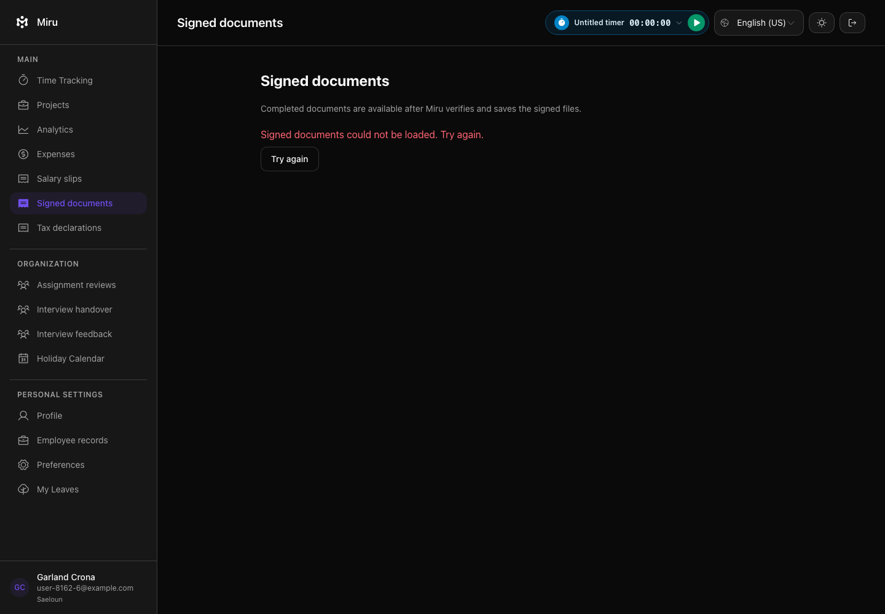
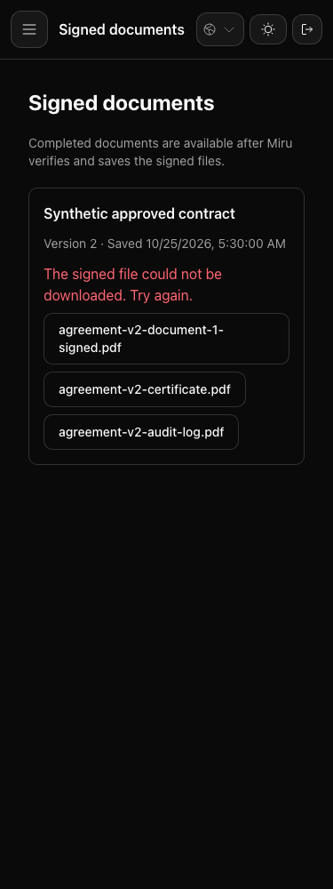

# Signing cancellation and private archive error evidence

These original, unedited native Brave screenshots accompany public PR2505. This
artifact-only branch starts at the reviewed application commit
`c428761a518aae02851444b55fbd7d13d9e941ac`, tree
`f10b17932877143ee0a9d54b6350cb697d65cde8`. It adds only this README and two PNGs;
the PR's application head and running CI are unchanged.

The pictures were captured on the same final JavaScript before the last
backend-only delivery reload correction. That correction changes no archive UI
or asset input. Subsequent exact-c428 checks passed 57 backend examples and four
native browser examples, including both pictured error/retry journeys and two
cancellation controls. All four console/exception arrays were empty, and all
seven changed source/spec hashes stayed stable. The earlier full archive 7/0 and
delivery 7/0 were separate commands; they are not presented as a new 14-case run.

## Desktop archive-list failure

The real controller action authorizes the synthetic employee first; a local test
then replaces its response with 503. The page names the failed operation and
offers its normal **Try again** action. The test retries to the same authorized
archive list. The screenshot shows the error state, not the retry result.

## Mobile private-file failure

At 375 pixels, a locally injected 503 after original download authorization shows
the file-specific error while retaining the same archive and wrapped filename
buttons. The test retries the same file and verifies its bytes; the picture
shows the recoverable error, not downloaded contents.

## Integrity, privacy and limits

| File | Original dimensions | SHA256 |
|---|---|---|
| signed-documents-load-error-1440.png |1440×1000|0164da696fb72515dff7d9ff64307600e14744aa667d472be155e0fca922f61e|
| signed-document-download-error-375.png |375×1000|4cf75310b121f24bdfb81b8e26f95c006416440bef44231b7dd61a2090a9afc7|

The displayed user/name/example.com address, approved-contract label and files
are synthetic local fixtures. No production employee, bank, tax, signing-token,
credential or real provider data is shown. No image was edited or composited.

The backend tests separately prove authenticated callback convergence,
normal/interrupted cancellation, stale/terminal handling and replay with one
cancellation request and one completion audit in the relevant simulated-provider
cases. Screenshots cannot establish those database/provider effects. Both Vite
modes and focused lint passed on the unchanged final JavaScript; TypeScript
remains 327 legacy diagnostics with zero added against the 329-error baseline. Hosted CI, real
provider acceptance and production verification remain separate. Publishing
these images is not a deployment or completion claim.
