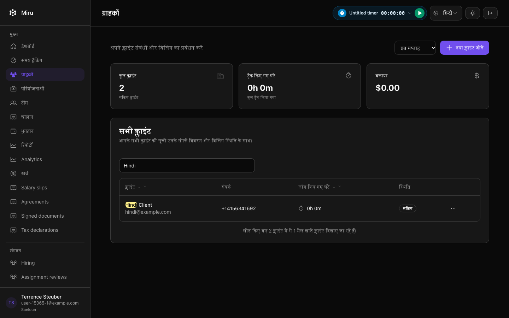
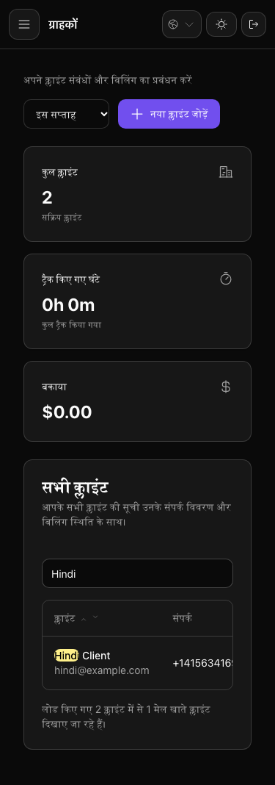

# Hindi client search verification

The longer whole-suite run stopped at 5,696 examples, one failure and 64 pending because the client-list spec still expected pagination and row-selection text. Client pagination was intentionally disabled in `029352347`. Testing the current search contract instead reproduced a real defect: the matching-client count fell back to English in Hindi mode.

The fix adds the missing Hindi translation. The browser spec now creates two clients, filters to one, checks the localized count and hidden nonmatching row, then opens the localized row menu and delete confirmation. Pagination remains disabled.

Verified locally:

- The updated Hindi scenario failed before the translation with `Viewing 1 matching client(s) from 2 loaded`.
- All nine client browser examples passed on the new translation. One focused scenario passed again after adding capture stabilization and primary-button bounds checks.
- Desktop (1440px) and mobile (375px) captures were inspected. The page stays within the viewport, the main action is fully visible, and the Hindi journey records no console errors. Initial captures taken during sidebar animation were discarded.
- `rtk mise exec -- timeout 30 bin/vite build` passed in test mode; the built Hindi chunk contains the new translation. Ruby lint passed. Prettier passed with its existing unknown-`tailwindConfig` warning.

This is native browser evidence, not a formal council/QA verdict or a complete whole-suite pass. All data is synthetic. Source and image hashes are recorded in `manifest.json`.

