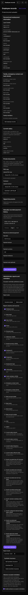
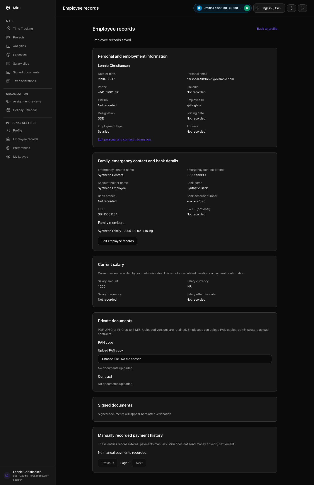
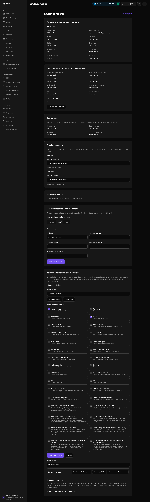
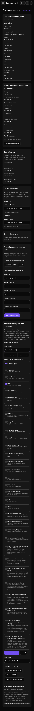
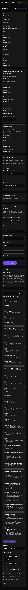

# Employee document download verification — #2461

PAN and contract downloads now fetch storage bytes before taking the user lock, then refresh the actor and recheck workspace, roles, active employment and the exact attachment. A changed attachment or purged file returns no PDF. Denied requests do not write a successful-download audit; active administrator and employee downloads still return the original bytes.

Verification on the source hashes in `manifest.json`:

- Five mutation-during-download regressions failed with HTTP 200 before the fix, then passed: workspace switch, role removal, actor resignation, target resignation and attachment replacement.
- A real attachment purge reproduced `NoMethodError`, then passed with the existing private 404 response.
- 54 profile/report/reminder backend examples passed; 10 Brave browser examples passed, including native exact-byte PAN download, missing-file handling and console/overflow checks.
- Ruby lint and Reek passed. Claude's source-only review of the race fix was advisory; the missing-attachment guard was added afterward with its own failing/passing test.

The full-suite attempt stopped at 2,955 examples, one failure and 64 pending: `spec/requests/api/v1/support_requests_spec.rb:19` ran an unrelated HubSpot job against the blocked external network. This is not a full-suite pass. No live data, provider calls or deployment were involved, and no formal QA/council verdict is asserted.

The post-fetch check does not serialize every role/employment mutation across the application. Other private-download endpoints are outside this fix.

## Browser captures

All five captures contain synthetic data:

