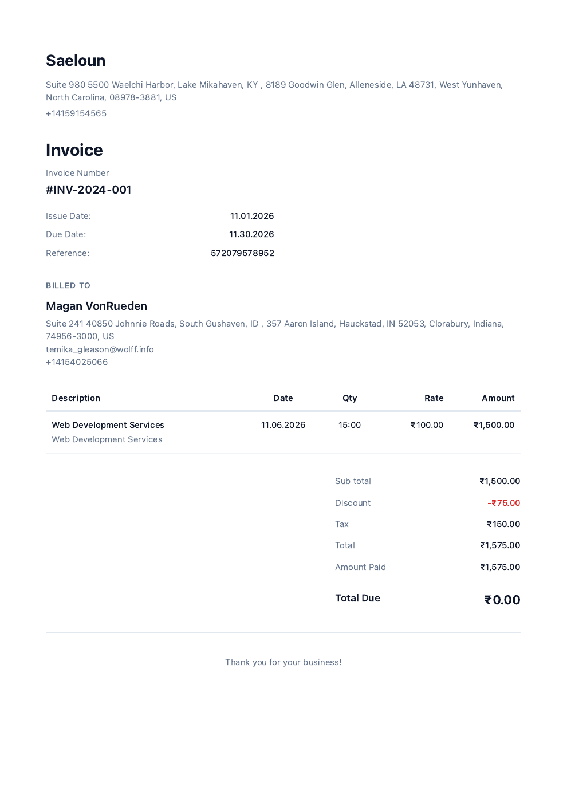

# Invoice PDF balance verification — 6 November 2026

## DEBUG REPORT

- **Symptom:** A downloaded invoice still demanded its full original charge after a partial or full payment. Its content request test was skipped with an incorrect compression explanation.
- **Root cause:** The shared invoice template rendered the calculated original charge under `Total Due`, ignoring the existing formatted balance. Separately, the global Ferrum test stub returned raw PDF text while the production caller decodes Ferrum's default Base64 result, producing garbage bytes.
- **Fix:** Use the existing formatted `invoice_amount_due` for the balance. When payments exist, retain the original Total and show Amount Paid using existing locals/translations. Base64-encode the default browser stub. Replace duplicate fake HTML/content checks with real request/template/Brave rendering and text extraction for unpaid, partially paid and fully paid invoices.
- **Evidence:** **37 focused examples, 0 failures**; **5,707 full non-system examples, 0 failures, 59 pending**. RuboCop and whitespace checks pass. All three generated fixtures pass `qpdf --check`, are one-page A4 PDFs and report no JavaScript.
- **Regression tests:** `spec/requests/api/v1/invoices/pdf_download_spec.rb`, `PDF content generation`.
- **Related:** Shared by invoice download, email, reminders and `Invoice#pdf_content`. This does not implement Sonam's pending consultant-invoice automation, official tax certificates or filing.
- **Status:** **DONE_WITH_CONCERNS** locally. Publishing/deployment remain gated; broader payroll requirements and external acceptance remain incomplete.

## Financial and rendering proof

The controller receives actual requests. The three invoice examples use the real ERB template, actual Ferrum/Brave renderer and `pdftotext`, with no replacement invoice HTML. The INR payment examples call `InvoicePayment::Settle` using synthetic bank-transfer records; no real financial action or email occurs.

| Invoice charge | Recorded payment | Printed balance |
| --- | --- | --- |
| ₹1,575.00 | ₹0.00 | ₹1,575.00 |
| ₹1,575.00 | ₹500.00 | ₹1,075.00 |
| ₹1,575.00 | ₹1,575.00 | ₹0.00 |

All examples verify the invoice, client/company, line item, ₹1,500 subtotal, ₹75 discount and ₹150 tax. Paid examples also assert the original total and amount paid. The paid and partially paid page images were visually inspected: legible rupee glyphs, aligned columns/amounts, no clipped text or overlapping payment rows. The unpaid image was inspected before the payment-row change; the unchanged unpaid branch was subsequently exercised by the final real-PDF request test.



This committed image uses generated test data. It is not a customer invoice or proof of a live transfer. PDFs remain local under `tmp/invoice-download-{unpaid,partially-paid,paid}.pdf`; the image and report are not available from published PR heads until this branch is pushed.

## Red/green and test scope

- Default renderer-stub request failed before the fix: the expected `%PDF-1.4` bytes had become binary garbage. It passes with strict Base64 encoding.
- Real partially paid and fully paid request cases each failed before the template fix: both printed ₹1,575 due instead of ₹1,075/₹0. The final focused and full suite include both passing cases.
- An earlier process-local zero-total mutation failed the initial unpaid real-PDF assertion. That probe preceded the balance fix; it is not current guard coverage and is excluded from final-suite proof.
- Final focused selection: invoice PDF requests and invoice PDF generation/email services, **37/0**. Log: `/tmp/miru-invoice-pdf-final-focused-20261106.log`.
- Final full backend command: `bundle exec rspec --exclude-pattern 'spec/system/**/*' --fail-fast`, **5707/0/59**, in 4m33.4s. Log: `/tmp/miru-backend-pdf-balance-final-20261106.log`. Outbound network was denied except localhost. No mutation helper was loaded.
- Both changed Ruby files pass RuboCop. The production change is ERB only; no JavaScript/TypeScript changed and no frontend build was rerun. Full browser application E2E and production PDF delivery were not run.

## Review disposition and remaining risks

Fresh tools-disabled Claude consultation completed. The response below is source analysis, not executed verification or council approval.

- **CI prerequisites:** `.github/workflows/validations.yml` installs `poppler-utils`/`qpdf` for both test jobs. The unit job uses `ubuntu-latest`; the [official Ubuntu runner image inventory](https://github.com/actions/runner-images/blob/main/images/ubuntu/Ubuntu2404-Readme.md#browsers-and-drivers) lists Chrome/Chromium. The responsive job separately installs its browser. No dependency-based skip was added. Exact-head CI still needs to run after publication.
- **Network/font concern:** The actual PDF layout contains no CDN import; the invoice uses system fonts. The successful render ran with external network denied and its rupee glyph was inspected.
- **Shared stub reach:** `PdfGeneration::BaseService` is the only application caller of `browser.pdf`; it decodes Base64. Full non-system regression passed after the shared-stub change.
- **Locales/email:** All 25 invoice-PDF locale dictionaries contain both reused labels. Download, mailers and reminders use the same invoice service/template. Focused email generation tests pass; no real email was sent.
- **Unpaid-row absence:** Claude's optional negative assertion was not added; the public requirement here is the correct balance, and the unpaid case verifies it through a real PDF.
- **Historical totals/rounding:** The existing original-total calculation and ledger rounding policy were preserved. Model/payment and line-item callbacks synchronize amounts in the exercised workflows. A separate small arithmetic probe shows existing half-cent formatting can round differently from Float ledger arithmetic; actual invoice reproduction and any rounding-policy change remain outside this fix. Do not claim every monetary boundary or historical inconsistent record has been validated.
- **Other currencies:** This regression covers INR. It does not establish cross-currency settlement correctness.

The pre-existing freeze boundary belonged to another task and was left untouched. Edits were confined to the shared invoice template, two spec files and this report/image. No production data, provider configuration, DNS, deployment, GitHub comment/review reply or real transfer changed.

## CLAUDE CODE SAYS (consult)

Model: claude-opus-5-5; session `2069c73e-d10c-40f3-9b79-53a90e603ab1`.

```tool-output
**Findings: one Medium, three Low. No High or blocking defects.**

**MEDIUM: CI dependencies in the new request specs** (`spec/requests/api/v1/invoices/pdf_download_spec.rb`, the three parameterized examples)
- The specs launch real Chrome through `Ferrum::Browser.new.and_call_original` and call the `pdftotext` binary.
- If the CI image lacks Chrome or poppler-utils, `Open3.capture3` raises `Errno::ENOENT` and the examples error out. They don't skip.
- If `layouts/pdf` loads Geist from the jsDelivr CDN, `wait_for_idle` depends on the network in CI. That can make the specs slow or flaky offline, and the `₹` glyph may come from a fallback font.
- Fix: confirm both binaries are installed in CI, or add an explicit `skip` guard when they're missing.

**LOW: Total can disagree with Amount Paid + Total Due** (`app/views/pdfs/invoices.html.erb:438-451`)
- `total` is recomputed from line items, tax and discount. Total Due uses the persisted `invoice.amount_due`.
- If the persisted `invoice.amount` ever differs from the recomputed total, the PDF shows Total − Paid ≠ Due.
- The test fixtures happen to agree (1575), so this isn't exercised. Consider whether the Total row should use `invoice_amount` (the persisted amount).

**LOW: Unpaid case lacks a negative assertion** (spec, `formatted_paid` nil branch)
- Nothing asserts that the Total and Amount Paid rows are *absent* when the invoice is unpaid.
- A regression that always renders those rows would still pass. Add `expect(text).not_to include("Amount Paid")`.

**LOW: Wider reach of the global stub change** (`spec/support/pdf_generation_stub.rb:20`)
- `pdf:` now returns Base64 text.
- Any other spec relying on this default stub, through a service that uses `browser.pdf` without decoding it (e.g. a `path:` option or raw passthrough), would now get Base64 instead of `%PDF` bytes.
- I can't verify this from the material supplied. Grep for other `browser.pdf` consumers before merging.

**Not verifiable from the material supplied:**
- That `pdfs.invoices.total` and `pdfs.invoices.amount_paid` exist in every shipped locale, not only `en`.
- That `Invoice#settle!` updates `amount_paid` and `amount_due` in invoice currency when `payment_currency` differs from the invoice currency.
- That the email path passes the same locals as the download path.

**No issues found in:**
- **Privacy:** no new data is exposed.
- **Rendering:** `nil.to_d` is safe.
- **Settlement:** the test settles through `Settle`, and the controller reloads the invoice from the DB.

This review covers the diff only, with no tests run. It is not council approval.
```

## Final source and image fingerprints

```text
78ecc482657b2f39360daabeb830997691f59f5e264aab59471ca0f5016d99da  app/views/pdfs/invoices.html.erb
51f6fc64a14d8426be4f9a31c3d14dbe581b17716d728ceddbabdcfec528eb5d  spec/requests/api/v1/invoices/pdf_download_spec.rb
5cdf69bd9d9d0025ff80dd479272c33e43485aa5b6a9a2fa887b88447a61ef9c  spec/support/pdf_generation_stub.rb
fa87c35674e62a3cf70f5a97c47c782ae099ad5ce01c4fdbad30e456b274fdae  output/playwright/invoice-pdf-balance-verification-20261106/paid-invoice.png
```
