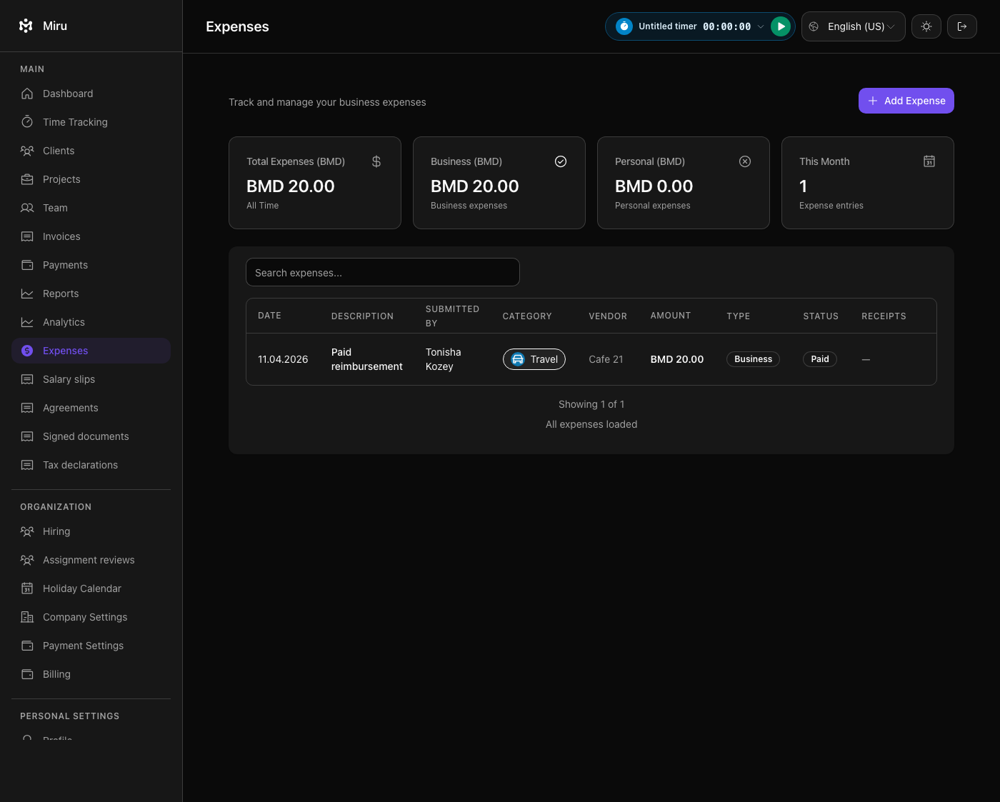

# Paid-expense browser verification

The broader browser run stopped at 104 examples because an older spec expected an edit menu on a paid reimbursement. The UI and backend already make paid expenses read-only (`a18f287f2`). The updated scenario requires the reimbursement row and its Paid status to be visible, with no expense-actions button, edit, delete or mark-paid action.

The same file contained a currency-entry test waiting for a success toast that the creation flow no longer emits. It now waits for the dialog to close and the created row to appear, asserts exactly one persisted expense, and checks an exact decimal USD 100 amount from `$100` input with USD explicitly configured.

Verification: 67 expense API/policy examples and all 10 expense browser examples passed. Ruby lint passed. The paid row was inspected in the native Brave capture below; all data is synthetic. Source and image hashes are in `manifest.json`.

These are test corrections and verification of existing behavior. Broader browser-suite completion, formal reviews, publication and live provider acceptance remain open.

