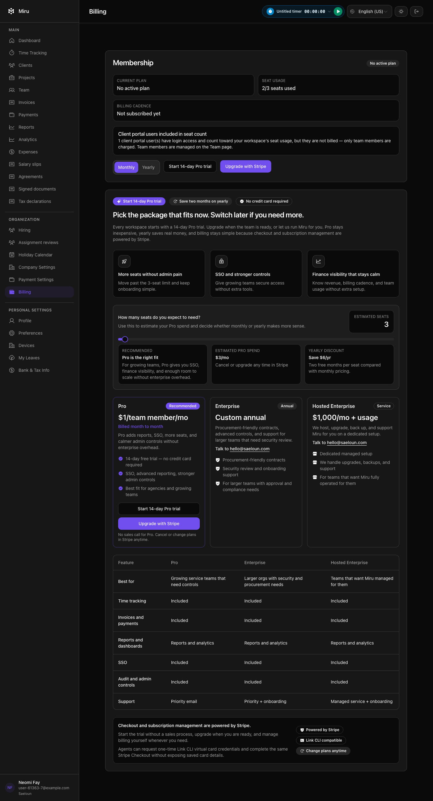
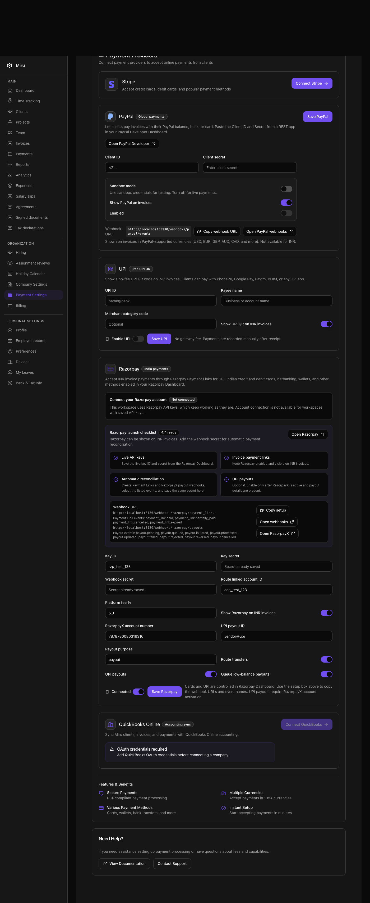

# Billing and payment settings verification — 2026-11-06

Candidate branch: `feature/sonam-release-integration-20261104`. Parent before this test-only change: `0e408d27c`.

## Changes and evidence

- Billing's client-portal browser expectation predated per-team-member billing (`9b583c1dd`). The actual page already explains that clients count toward workspace seat usage but are not billed. The corrected assertion retains the exact one-client count, the existing `2/3 seats used` assertion and the explicit client-not-billed explanation. The existing subscription request example independently checks two used seats, one billable seat and one client portal user.
- The payment settings group created a resigned administrator: the employment factory defaults `resigned_at` to 2021–22. Razorpay management correctly denied that fixture, leaving API-key controls hidden. The test now creates an actively employed administrator with `resigned_at: nil`, matching the existing connection suite. The authorization policy and product code are unchanged.
- Two screenshot checkpoints capture the client-seat explanation and existing legacy Razorpay checklist/webhook setup. They contain synthetic local fixtures, not production accounts or provider readiness evidence. Screenshots were visually inspected.

## Checks

Disposable native Brave/Cuprite sessions used localhost port 3130 and an owned local test database. The sandbox allowed only localhost outbound network traffic. No real payment or provider onboarding occurred.

- Original general browser run after the CLI fix: **339 examples, 1 failure, 2 pending**, stopping on the obsolete billing sentence.
- Initial remaining-browser selection after correcting billing: **46 examples, 1 failure**, stopping on the resigned payment-admin fixture.
- Final focused billing/payment browser files: **23 examples, 0 failures**, exit 0.
- Subscription API file: **23 examples, 0 failures**, exit 0; includes the used-versus-billable seat assertions.
- Razorpay connection request file: **50 examples, 0 failures**, exit 0; includes authorization and lost-membership coverage.
- Ruby lint: **2 files, no offenses**. Whitespace and source/screenshot fingerprints passed before commit.
- Remaining-browser selection after both corrections (`settings`, `teams`, `time_tracking`, `users`): **99 examples, 1 failure**, stopping at `spec/system/time_tracking/add_entry_spec.rb:407`; `.week-view[data-view='month']` was not found. That failure has not been diagnosed in this unit. This is not a complete browser pass.

Logs remain local: `/tmp/miru-billing-payment-browser-green-20261106.log`, `/tmp/miru-billing-api-green-20261106.log`, `/tmp/miru-razorpay-access-green-20261106.log`, and `/tmp/miru-browser-tail-final-20261106.log`.

The latest full backend run on the unchanged product source remains **5,692 examples, 0 failures, 64 pending**. Pending acceptance requirements are unfinished. No JavaScript/TypeScript or application runtime source changed in this unit; no new asset build was run.

## Screenshots

## Release limits

These results are local and unpublished. Exact-head council reviews remain missing. Render's old production web and worker are suspended with automatic deployment off. Hatchbox lists the private release branch last deployed November 2; configured active processes do not prove runtime health. Live Razorpay/Mercury onboarding, transfers, Hetzner health and signed-in production flows were not verified. The existing personal-browser connection is unavailable.
