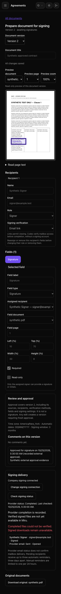
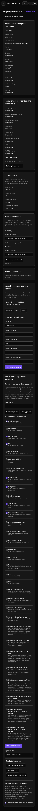
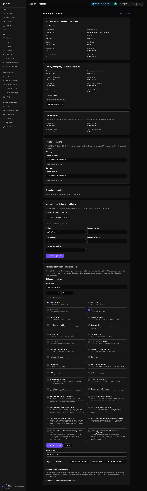
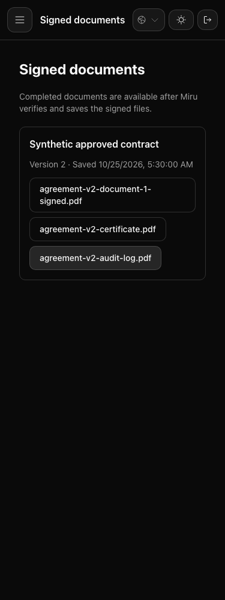
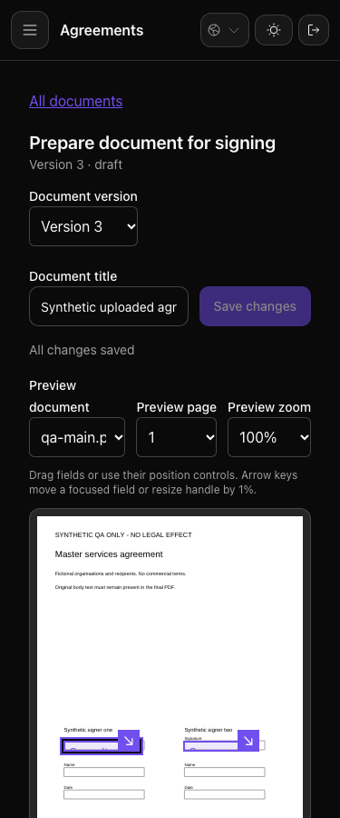
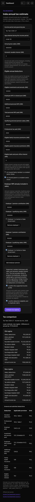
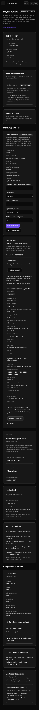
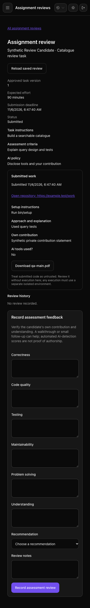

# Combined Sonam browser regression

**Formal evidence-helper status: inconclusive (`no evidence rows`).** The
helper did not turn this native-browser run into structured capture rows. Its
published verdict is retained in [evidence.json](evidence.json); no clean QA or
review gate is claimed. The native test results and screenshots below remain
separate, directly observed evidence.

**121 browser examples, 0 failures**, plus the initial **1-example archive
rejection probe, 0 failures**. The full run completed in 5 minutes 3 seconds,
within the original 900-second deadline. No application fix was needed in this
run. The archive failure fixture now reaches native PDF reconciliation instead
of inserting a failure status directly.

The consumed code was candidate `a7ad6d274` plus two owned system-spec changes.
Application/frontend sources and build inputs are unchanged. The earlier
**1,718-example backend run** remains separate evidence. The test asset task
initially skipped its cached build; `bin/vite build --mode=test --force` then
completed successfully and transformed 9,803 modules before the browser started.

## Scope and isolation

Existing RSpec/Cuprite system tests ran the app in headless Brave at
`http://localhost:3130`. Records, users, documents, keys and financial values are
synthetic. A dedicated local PostgreSQL database and localhost-only network
sandbox isolate the run. External provider HTTP and mail are test doubles.
The personal browser was not used.

| Contracts | Result |
| --- | --- |
| Short sealed PDF rejection and unavailable signed download | Pass; real parser/seal/reconciliation path, desktop/mobile failure view |
| Employee, consultant and client signed archive access | Pass; downloaded files match archived SHA-256 values |
| Profile/family/bank fields, salary controls, private data clearing | Pass, including staff/client/workspace boundaries |
| Custom report edits and CSV download | Pass; persisted definitions and selected headers checked |
| PDF upload, recipient authentication, field placement, version/review/delivery recovery | Pass |
| Client legal identity and optional agreement authoring | Pass |
| Consultant payroll, tax declarations/proof, India estimate interfaces | Pass against their existing configured assertions; no statutory/legal audit is claimed |
| Razorpay connection/collection holds, Mercury returns, invoice dates | Pass with provider doubles |
| ATS forms and private assessment downloads | Pass |

Browser exceptions fail the driver. Scenario console/overflow checks pass,
including explicit negative and error-detection cases. Expected rejection
responses and deliberately injected errors are not counted as unexpected
application errors.

## Evidence

There are **84 fresh screenshots**: 82 from the combined run and two from its
focused precursor. Eight representative images were opened and inspected.
Existing runtime images were checked for preservation; none were present before
the full run. New images saved by legacy tests were collected afterward.

The [hash manifest](screenshots.json), [run results](results.json),
[executed script](executed-script.txt), [initial checkpoint](exploration-001.json), [charter](charter.md) and
[additional journey charter](extended-charter.md) retain this run's scope and
observations. Raw RSpec logs remain local at
`/tmp/miru-sonam-combined-browser-full-20261104.log`.

The provisional score is **100 for the tested automated functional/console
assertions only**. Other categories are excluded rather than assumed clean.
The initial single-case probe has different coverage, so no score delta is
computed. No new defects were identified within these regression contracts.

## Release limits

These results do not establish live Mercury/Razorpay connectivity, production
payment success, current statutory completeness, official Form 16/ITR filing,
or production Documenso commissioning. No production configuration, DNS, real
email or transfer changed. Required exact-commit reviews and published-head CI
remain before release. The new screenshot embeds await code publication.

## Inspected views

## All captured screenshots

- [additional/agreement-create-recovery.png](additional/agreement-create-recovery.png)
- [additional/agreement-import-recovery.png](additional/agreement-import-recovery.png)
- [additional/agreement-long-mobile-draft.png](additional/agreement-long-mobile-draft.png)
- [additional/agreement-long-mobile-field-settings.png](additional/agreement-long-mobile-field-settings.png)
- [additional/agreement-pdf-recovery.png](additional/agreement-pdf-recovery.png)
- [additional/client-agreement-details-1440.png](additional/client-agreement-details-1440.png)
- [additional/client-agreement-details-390.png](additional/client-agreement-details-390.png)
- [additional/client-agreement-fields-1440.png](additional/client-agreement-fields-1440.png)
- [additional/client-agreement-fields-390.png](additional/client-agreement-fields-390.png)
- [additional/india-tax-2025.png](additional/india-tax-2025.png)
- [additional/india-tax-2026.png](additional/india-tax-2026.png)
- [additional/india-tax-deductions-mobile.png](additional/india-tax-deductions-mobile.png)
- [additional/india-tax-no-stale.png](additional/india-tax-no-stale.png)
- [additional/signature-authentication-1440.png](additional/signature-authentication-1440.png)
- [additional/signature-authentication-375.png](additional/signature-authentication-375.png)
- [additional/signature-placement-desktop.png](additional/signature-placement-desktop.png)
- [additional/signature-placement-mobile.png](additional/signature-placement-mobile.png)
- [additional/signature-review-desktop.png](additional/signature-review-desktop.png)
- [additional/signature-review-email-desktop.png](additional/signature-review-email-desktop.png)
- [additional/signature-review-email-mobile.png](additional/signature-review-email-mobile.png)
- [additional/signature-review-mobile.png](additional/signature-review-mobile.png)
- [additional/signature-upload-recovery.png](additional/signature-upload-recovery.png)
- [employee-records/employee-records-admin-mobile.png](employee-records/employee-records-admin-mobile.png)
- [employee-records/employee-records-staff.png](employee-records/employee-records-staff.png)
- [employee-records/employee-report-editor-desktop.png](employee-records/employee-report-editor-desktop.png)
- [employee-records/employee-report-editor-mobile.png](employee-records/employee-report-editor-mobile.png)
- [employee-records/employee-report-saved-mobile.png](employee-records/employee-report-saved-mobile.png)
- [focused-signing/short-signed-document-rejected-1440.png](focused-signing/short-signed-document-rejected-1440.png)
- [focused-signing/short-signed-document-rejected-375.png](focused-signing/short-signed-document-rejected-375.png)
- [hiring/admin-download.png](hiring/admin-download.png)
- [hiring/reviewer-download.png](hiring/reviewer-download.png)
- [mercury/returned-after-refresh-1400.png](mercury/returned-after-refresh-1400.png)
- [mercury/returned-after-refresh-390.png](mercury/returned-after-refresh-390.png)
- [razorpay/01-not-configured-desktop.png](razorpay/01-not-configured-desktop.png)
- [razorpay/01-not-configured-mobile.png](razorpay/01-not-configured-mobile.png)
- [razorpay/02-legacy-api-keys-desktop.png](razorpay/02-legacy-api-keys-desktop.png)
- [razorpay/02-legacy-api-keys-mobile.png](razorpay/02-legacy-api-keys-mobile.png)
- [razorpay/03-connect-or-create-desktop.png](razorpay/03-connect-or-create-desktop.png)
- [razorpay/03-connect-or-create-mobile.png](razorpay/03-connect-or-create-mobile.png)
- [razorpay/04-connected-desktop.png](razorpay/04-connected-desktop.png)
- [razorpay/04-connected-mobile.png](razorpay/04-connected-mobile.png)
- [razorpay/05-public-invoice-collecting-desktop.png](razorpay/05-public-invoice-collecting-desktop.png)
- [razorpay/05-public-invoice-collecting-mobile.png](razorpay/05-public-invoice-collecting-mobile.png)
- [razorpay/06-merchant-unconfirmed-desktop.png](razorpay/06-merchant-unconfirmed-desktop.png)
- [razorpay/06-merchant-unconfirmed-mobile.png](razorpay/06-merchant-unconfirmed-mobile.png)
- [razorpay/08-revocation-pending-desktop.png](razorpay/08-revocation-pending-desktop.png)
- [razorpay/08-revocation-pending-mobile.png](razorpay/08-revocation-pending-mobile.png)
- [razorpay/09-recovery-needed-desktop.png](razorpay/09-recovery-needed-desktop.png)
- [razorpay/09-recovery-needed-mobile.png](razorpay/09-recovery-needed-mobile.png)
- [razorpay/10-recovery-in-progress-desktop.png](razorpay/10-recovery-in-progress-desktop.png)
- [razorpay/10-recovery-in-progress-mobile.png](razorpay/10-recovery-in-progress-mobile.png)
- [razorpay/11-revoked-reconnect-desktop.png](razorpay/11-revoked-reconnect-desktop.png)
- [razorpay/11-revoked-reconnect-mobile.png](razorpay/11-revoked-reconnect-mobile.png)
- [razorpay/12-payment-needs-review-desktop.png](razorpay/12-payment-needs-review-desktop.png)
- [razorpay/12-payment-needs-review-mobile.png](razorpay/12-payment-needs-review-mobile.png)
- [razorpay/13-payment-unknown-amount-desktop.png](razorpay/13-payment-unknown-amount-desktop.png)
- [razorpay/13-payment-unknown-amount-mobile.png](razorpay/13-payment-unknown-amount-mobile.png)
- [razorpay/14-link-needs-confirmation-desktop.png](razorpay/14-link-needs-confirmation-desktop.png)
- [razorpay/14-link-needs-confirmation-mobile.png](razorpay/14-link-needs-confirmation-mobile.png)
- [razorpay/15-status-unavailable-desktop.png](razorpay/15-status-unavailable-desktop.png)
- [razorpay/15-status-unavailable-mobile.png](razorpay/15-status-unavailable-mobile.png)
- [razorpay/16-last-known-status-desktop.png](razorpay/16-last-known-status-desktop.png)
- [razorpay/16-last-known-status-mobile.png](razorpay/16-last-known-status-mobile.png)
- [razorpay/17-invalid-link-id-desktop.png](razorpay/17-invalid-link-id-desktop.png)
- [razorpay/17-invalid-link-id-mobile.png](razorpay/17-invalid-link-id-mobile.png)
- [razorpay/18-invalid-link-id-light-desktop.png](razorpay/18-invalid-link-id-light-desktop.png)
- [razorpay/18-invalid-link-id-light-mobile.png](razorpay/18-invalid-link-id-light-mobile.png)
- [razorpay/19-public-invoice-on-hold-desktop.png](razorpay/19-public-invoice-on-hold-desktop.png)
- [razorpay/19-public-invoice-on-hold-mobile.png](razorpay/19-public-invoice-on-hold-mobile.png)
- [razorpay/20-public-invoice-under-review-desktop.png](razorpay/20-public-invoice-under-review-desktop.png)
- [razorpay/20-public-invoice-under-review-mobile.png](razorpay/20-public-invoice-under-review-mobile.png)
- [razorpay/21-client-invoice-on-hold-desktop.png](razorpay/21-client-invoice-on-hold-desktop.png)
- [razorpay/21-client-invoice-on-hold-mobile.png](razorpay/21-client-invoice-on-hold-mobile.png)
- [razorpay/22-payment-confirmation-page-desktop.png](razorpay/22-payment-confirmation-page-desktop.png)
- [razorpay/22-payment-confirmation-page-mobile.png](razorpay/22-payment-confirmation-page-mobile.png)
- [razorpay/23-paid-invoice-closed-desktop.png](razorpay/23-paid-invoice-closed-desktop.png)
- [razorpay/23-paid-invoice-closed-mobile.png](razorpay/23-paid-invoice-closed-mobile.png)
- [signing/client-signed-documents.png](signing/client-signed-documents.png)
- [signing/employee-signed-documents.png](signing/employee-signed-documents.png)
- [signing/short-signed-document-rejected-1440.png](signing/short-signed-document-rejected-1440.png)
- [signing/short-signed-document-rejected-375.png](signing/short-signed-document-rejected-375.png)
- [signing/signed-documents-1440.png](signing/signed-documents-1440.png)
- [signing/signed-documents-375.png](signing/signed-documents-375.png)
- [signing/signed-editor-downloads.png](signing/signed-editor-downloads.png)
