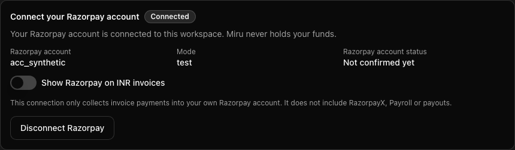
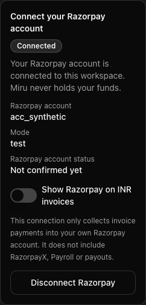
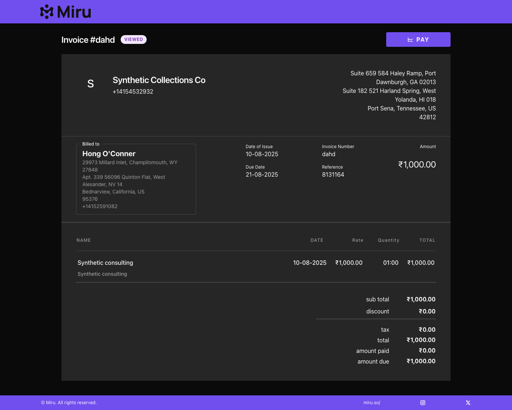
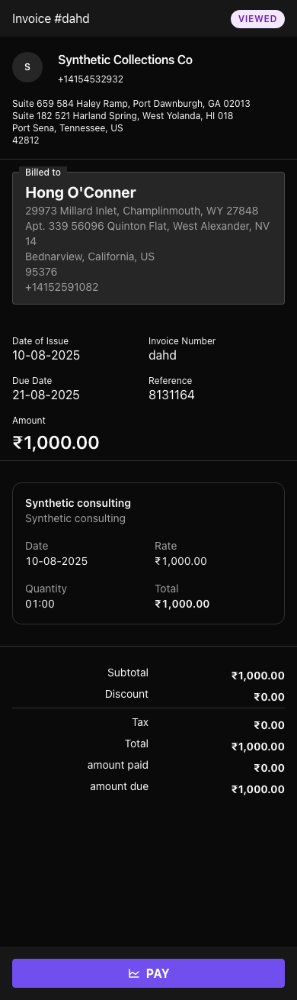
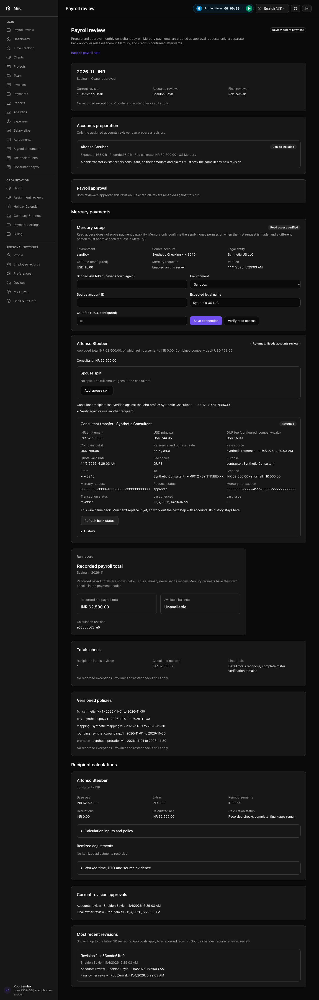
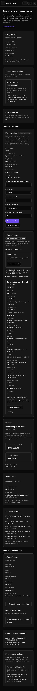
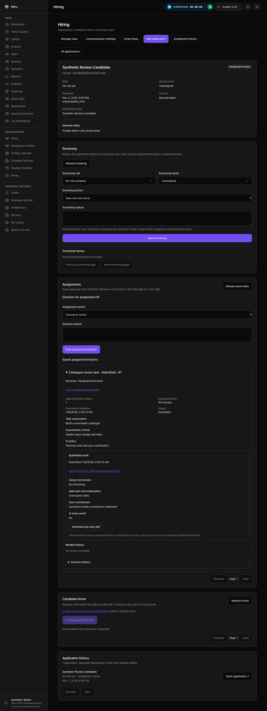
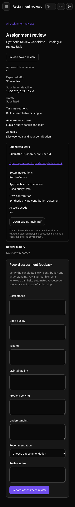

# Sonam release integration: local verification

This candidate combines the implemented ATS, employee records/signing, Razorpay
collection and Mercury consultant-payroll work. All runtime evidence uses synthetic records, a dedicated
local PostgreSQL database, real headless Brave and an outbound-network sandbox
allowing localhost only. No live banking connection or production deployment
was exercised.

## Source inputs

| Input | Revision |
| --- | --- |
| Public develop baseline | `10e457e1d` |
| ATS, PR #2479 | `186e48cc0` |
| Mercury, PR #2492 | `7dcc3dd0a` |
| Razorpay, PR #2488 | `07070cfd8` (includes `281764efa` and `0191f78dc`) |
| Signing page-count follow-up, #2462 | `2fe61870e` |

Manual merge resolutions retain the combined request-log redactions, all
changelog entries, and default/production schedules for hiring recovery,
subscription purchase recovery, Mercury polling and Razorpay token/link
maintenance. Added regression checks cover the shared privacy roots and
provider schedules.

## Verification

- Clean develop baseline: **12 examples, 0 failures**.
- ATS plus Mercury intermediate candidate: **169 examples, 0 failures**.
- Final combined backend at `22c37049d`, after the signing follow-up: **1,718 examples, 0
  failures** across payroll, payment providers, settlement, subscription
  delivery, jobs, hiring, signing, employee records, customizable reports,
  occasion reminders and relevant request boundaries.
- Combined browser run: **51 examples, 0 failures** covering Razorpay connection
  and payment holds, invoice calendar dates, Mercury returns, candidate forms,
  and staff assessment review/downloads.
- The subsequent fixture-only correction was rerun in the candidate: **1
  example, 0 failures**, recapturing the six affected connection/invoice images.
- Frozen dependency install, the required `timeout 30 bin/vite build`, forced
  test-asset build, RuboCop and commit hooks passed. Frontend sources, package
  inputs and Vite configuration were unchanged by the Stripe/signing follow-ups.
  Browser results and screenshots above precede those backend-only fixes.

## Review follow-up

The independent source review's unmatched-payment-intent concern was checked:
the fulfillment service returns false for an unmatched intent, and the webhook
acknowledges it. Provider event IDs are persisted with a unique index; polling
jobs exist and use a configured queue.

Checkout settlement exceptions did return HTTP 400. The new regression
reproduced that response before the fix. They now return HTTP 500 with a
constant error message, while a mismatched invoice intent retains HTTP 400.
Failure leaves the invoice unpaid with no payment row; a successful retry
records one payment and replay records none. Both event types and invalid
checkout behavior pass in **24 focused examples** on the Razorpay branch.
[Stripe webhook reference](https://docs.stripe.com/webhooks).

A distinct Stripe capture arriving after another provider paid the invoice was
also silently ignored. Both webhook regressions reproduced the missing ledger
entry. `07070cfd8` records identifiable late captures with a reconciliation note
and actual captured currency, preserving the paid invoice balance and avoiding
another confirmation email. Replays and both checkout/intent delivery orders
produce one entry. The shared settlement commit checks also preserve distinct
captures after an earlier canonically referenced Stripe payment.

Legacy Stripe rows with no PaymentIntent reference remain ambiguous. They do
not receive another ledger credit; a Sentry warning includes the invoice and
incoming provider reference for manual reconciliation. Historical audit remains
a rollout requirement. Normal unpaid checkout currency handling is unchanged;
this fix does not add a general currency-mismatch reconciliation workflow or
automatically refund overpayments.

The source branch passed **144 related payment examples**, followed by **13
settlement examples** after strengthening the prior-capture fixture. RuboCop,
Reek (zero warnings), commit hooks and direct diff checks passed. Claude's
source-only second opinion exposed the legacy replay risk and missing reverse
delivery order; it was advisory, not a council approval.

The #2462 follow-up rejects a completed signed item with fewer pages than its
approved source before uploading its archive blob. Both the single-document
and later-item cleanup regressions failed on the unchanged service. The latter
also verifies that an earlier staged file is physically deleted. Existing seal,
envelope, original-byte and separate certificate/audit checks remain in place.
The final source branch passed **187 signing service/API examples**, then **23
reconciliation examples** after strengthening the storage assertion.

Claude's source-only review raised a provider compatibility concern. The pinned
Documenso seal job confirmed that team settings can append certificate/audit
pages before sealing; exact page-count equality would reject valid contracts.
The final guard therefore requires a minimum count and permits added pages.
Counts do not prove semantic fidelity or detect every omitted page masked by
appended evidence. Existing archives are unchanged. See the
[signing verification receipt](../../../docs/qa/generic-document-signing-2462/page-count-reconciliation.md).

Screenshot review also caught an inconsistent demo invoice with a balance but
no line items. The fixture now includes its INR 1,000 consulting item; the
recaptured subtotal, total and amount due agree. This changed test data.

## Screenshots

**48 screenshots captured; the eight views below were opened and inspected.**
All names, accounts and financial values are synthetic. Browser checks include
per-scenario console/exception and overflow assertions, including deliberate
error-detection and failure-recovery cases.

### Razorpay connection

### Consistent INR invoice

### Returned consultant payment

### Private assessment downloads

All 48 captured screenshots

- [hiring/admin-download.png](hiring/admin-download.png)
- [hiring/reviewer-download.png](hiring/reviewer-download.png)
- [mercury/returned-after-refresh-1400.png](mercury/returned-after-refresh-1400.png)
- [mercury/returned-after-refresh-390.png](mercury/returned-after-refresh-390.png)
- [razorpay/01-not-configured-desktop.png](razorpay/01-not-configured-desktop.png)
- [razorpay/01-not-configured-mobile.png](razorpay/01-not-configured-mobile.png)
- [razorpay/02-legacy-api-keys-desktop.png](razorpay/02-legacy-api-keys-desktop.png)
- [razorpay/02-legacy-api-keys-mobile.png](razorpay/02-legacy-api-keys-mobile.png)
- [razorpay/03-connect-or-create-desktop.png](razorpay/03-connect-or-create-desktop.png)
- [razorpay/03-connect-or-create-mobile.png](razorpay/03-connect-or-create-mobile.png)
- [razorpay/04-connected-desktop.png](razorpay/04-connected-desktop.png)
- [razorpay/04-connected-mobile.png](razorpay/04-connected-mobile.png)
- [razorpay/05-public-invoice-collecting-desktop.png](razorpay/05-public-invoice-collecting-desktop.png)
- [razorpay/05-public-invoice-collecting-mobile.png](razorpay/05-public-invoice-collecting-mobile.png)
- [razorpay/06-merchant-unconfirmed-desktop.png](razorpay/06-merchant-unconfirmed-desktop.png)
- [razorpay/06-merchant-unconfirmed-mobile.png](razorpay/06-merchant-unconfirmed-mobile.png)
- [razorpay/08-revocation-pending-desktop.png](razorpay/08-revocation-pending-desktop.png)
- [razorpay/08-revocation-pending-mobile.png](razorpay/08-revocation-pending-mobile.png)
- [razorpay/09-recovery-needed-desktop.png](razorpay/09-recovery-needed-desktop.png)
- [razorpay/09-recovery-needed-mobile.png](razorpay/09-recovery-needed-mobile.png)
- [razorpay/10-recovery-in-progress-desktop.png](razorpay/10-recovery-in-progress-desktop.png)
- [razorpay/10-recovery-in-progress-mobile.png](razorpay/10-recovery-in-progress-mobile.png)
- [razorpay/11-revoked-reconnect-desktop.png](razorpay/11-revoked-reconnect-desktop.png)
- [razorpay/11-revoked-reconnect-mobile.png](razorpay/11-revoked-reconnect-mobile.png)
- [razorpay/12-payment-needs-review-desktop.png](razorpay/12-payment-needs-review-desktop.png)
- [razorpay/12-payment-needs-review-mobile.png](razorpay/12-payment-needs-review-mobile.png)
- [razorpay/13-payment-unknown-amount-desktop.png](razorpay/13-payment-unknown-amount-desktop.png)
- [razorpay/13-payment-unknown-amount-mobile.png](razorpay/13-payment-unknown-amount-mobile.png)
- [razorpay/14-link-needs-confirmation-desktop.png](razorpay/14-link-needs-confirmation-desktop.png)
- [razorpay/14-link-needs-confirmation-mobile.png](razorpay/14-link-needs-confirmation-mobile.png)
- [razorpay/15-status-unavailable-desktop.png](razorpay/15-status-unavailable-desktop.png)
- [razorpay/15-status-unavailable-mobile.png](razorpay/15-status-unavailable-mobile.png)
- [razorpay/16-last-known-status-desktop.png](razorpay/16-last-known-status-desktop.png)
- [razorpay/16-last-known-status-mobile.png](razorpay/16-last-known-status-mobile.png)
- [razorpay/17-invalid-link-id-desktop.png](razorpay/17-invalid-link-id-desktop.png)
- [razorpay/17-invalid-link-id-mobile.png](razorpay/17-invalid-link-id-mobile.png)
- [razorpay/18-invalid-link-id-light-desktop.png](razorpay/18-invalid-link-id-light-desktop.png)
- [razorpay/18-invalid-link-id-light-mobile.png](razorpay/18-invalid-link-id-light-mobile.png)
- [razorpay/19-public-invoice-on-hold-desktop.png](razorpay/19-public-invoice-on-hold-desktop.png)
- [razorpay/19-public-invoice-on-hold-mobile.png](razorpay/19-public-invoice-on-hold-mobile.png)
- [razorpay/20-public-invoice-under-review-desktop.png](razorpay/20-public-invoice-under-review-desktop.png)
- [razorpay/20-public-invoice-under-review-mobile.png](razorpay/20-public-invoice-under-review-mobile.png)
- [razorpay/21-client-invoice-on-hold-desktop.png](razorpay/21-client-invoice-on-hold-desktop.png)
- [razorpay/21-client-invoice-on-hold-mobile.png](razorpay/21-client-invoice-on-hold-mobile.png)
- [razorpay/22-payment-confirmation-page-desktop.png](razorpay/22-payment-confirmation-page-desktop.png)
- [razorpay/22-payment-confirmation-page-mobile.png](razorpay/22-payment-confirmation-page-mobile.png)
- [razorpay/23-paid-invoice-closed-desktop.png](razorpay/23-paid-invoice-closed-desktop.png)
- [razorpay/23-paid-invoice-closed-mobile.png](razorpay/23-paid-invoice-closed-mobile.png)

## Release status

These are local results, separate from published-head CI and the required
exact-commit engineering/design/developer-experience reviews. The PR branches
and candidate have not been pushed or deployed by this work. Provider account
activation, live transfers and remaining issue acceptance items are unverified.

## Latest combined browser run

After `a7ad6d274`, two system specs were strengthened for actual short-PDF
reconciliation and fresh screenshot destinations. Application/frontend sources
are unchanged. The wider run passed **121 examples, 0 failures**, following a
passing focused archive case. It covers the existing profile, report, document
preparation/authoring, signing/archive, consultant payroll, tax, payment and ATS
journeys together, with native byte-verified downloads and scenario console/
overflow checks. Test assets were force-built before the owned Brave testserver.

The fresh [browser report](../sonam-combined-browser-20261104T010820Z/qa-report-localhost-2026-11-04.md)
contains **84 synthetic screenshots**; eight representative images were opened
and inspected. These supplement the earlier 48-image gallery above. The formal
evidence-helper verdict is **inconclusive (`no evidence rows`)**; native test
results are distinct from a clean QA/review gate. Live-provider and production
acceptance remain unverified.
