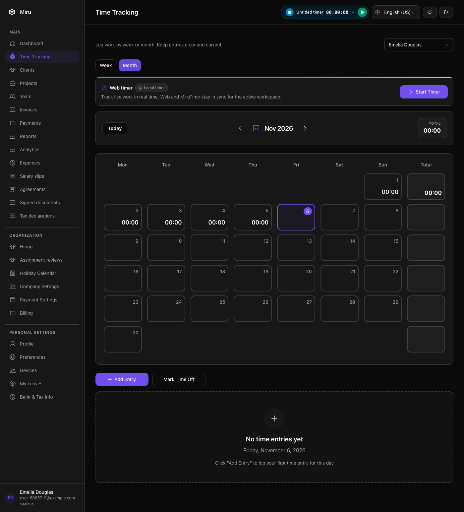

# Time-tracking view stability — 2026-11-06

Branch: `feature/sonam-release-integration-20261104`; parent before this unit: `e5ac6685d`.

```text
DEBUG REPORT
Symptom: Month clicks sometimes leave the page on Week.
Root cause: Loading the employee selector grows the toolbar from 20px to 40px, moving the view tabs down 20px between coordinate lookup and native click.
Fix: Reserve the desktop selector's height with lg:min-h-10. Keep handlers, authorization and existing Month assertions unchanged.
Evidence: Original case failed 5/10 on develop and 6/10 on the candidate, then passed 10/10 after the fix. Forced response-gated layout check failed 179 != 159 before the fix and passed afterward.
Regression test: spec/system/time_tracking/add_entry_spec.rb; employee-filter response is delayed while tab position is measured, then released and checked.
Related: The broader run also exposed an obsolete visible Selected expectation. Its replacement checks the prior-week form date and actual persisted work_date.
Status: DONE_WITH_CONCERNS; all selected local checks pass, but production release remains gated and unverified.
```

## Changes

- One application class reserves the async employee selector's `h-10` height at the desktop breakpoint. The resolved Tailwind `lg` is `1024px`, matching `AppWithUserData`'s media query.
- The new layout check gates the actual time-tracking API response after rendering, compares the tab position before/after the selector appears, and switches to Month. It closes the queue and restores the original viewport in `ensure`. No sleep, looser bound or retry was added.
- The old prior-week test expected visible `Selected` text; the real day button uses `aria-pressed` and an accessibility label. The test now waits for the visible date paragraph, verifies the form's date after navigating back one week, creates an entry, and checks its saved `work_date`.
- The existing browser CI job now includes the complete add-entry file. Its required check name, contents-read permission and 30-minute timeout are unchanged.

## Flake evidence

The pre-navigation CDP trace recorded a native pointerdown/up/click on a **DIV at y=177**, so the Month handler never ran. A separate layout trace measured `monthTop=159, headerHeight=20, selects=0` before the API data and `monthTop=179, headerHeight=40, selects=1` after it.

| Consumed application source | Original Month workflow failures | Completed trials |
| --- | --- | --- |
| origin/develop baseline | 5 | 10 |
| candidate before the fix | 6 | 10 |
| candidate after the fix | 0 | 10 |

Both before sets ran under the same concurrent load in separate worktrees/databases/ports. Every failed trial stopped at the Month selector assertion; no startup or unrelated failures were counted. The original Month example body and wait limits were unchanged across these measurements. The new response-gated regression deterministically produced `Expected 179 to eq 159` before the application fix.

An early after-hook instrumentation attempt read localStorage on about:blank after browser reset and was discarded. A separate instrumented copy passed ten times but changed the timing; those passes are diagnostic only, not the fix's green evidence.

The bug reproduces on develop, so it predates the integrated PR. The existing browser job previously omitted this general time-tracking file. No historical per-case CI duration/retry metrics were retrieved, so its first CI failure is not dated. Static history identifies `6dfbbdf1b` for the employee-selector condition; that is not asserted as the first failing deployed revision. Routing: fix this pre-existing bug in the current release.

## Checks

- Forced test red: **1 example, 1 failure**, position shifted 159→179.
- Original Month workflow after CSS fix: **10 trials, 0 failures**.
- Focused layout, Month and prior-week flows: **3 examples, 0 failures**, before the final viewport/date-read test refinements.
- Broader settings/team/time-tracking/sign-in plus mobile/tablet route selection: **141 examples, 0 failures** on the final application source, before those final test-only refinements.
- Final full add-entry file after the refinements: **20 examples, 0 failures**, exit 0.
- An intentional mutation changed the created entry's work_date to the current week: **1 example, 1 expected failure**. The same real workflow without the mutation passes. This confirms the updated prior-week test detects a wrong save target.
- Final expanded CI browser selection: **269 examples, 0 failures**, exit 0, in 9 minutes 44 seconds. This matches the configured browser selection and includes the final test refinements. It is a local run, not a GitHub Actions result.
- Fresh forced Vite test build: **9,803 modules transformed**, exit 0. The required `rtk mise exec -- timeout 30 bin/vite build` also exited 0 and reused that fresh build.
- Changed-file ESLint and Ruby lint passed. Workflow YAML parsed; its exact browser command and unchanged check name/permissions/timeout were verified.

All browser checks used disposable native Brave/Cuprite sessions, owned local databases and localhost-only outbound networking. Cuprite's JavaScript-exception checking is enabled. This does not assert that every console message was audited. No production data, provider onboarding or real payment was used.

Logs remain local: `/tmp/miru-month-{develop-before,candidate-before,candidate-after}-summary-20261106.json`, `/tmp/miru-month-navigation-probe-20261106.log`, `/tmp/miru-month-layout-probe-20261106.log`, `/tmp/miru-toolbar-layout-red-20261106.log`, `/tmp/miru-toolbar-final-focused-20261106.log`, `/tmp/miru-toolbar-browser-cohort-final-20261106.log`, `/tmp/miru-toolbar-add-entry-final-20261106.log`, `/tmp/miru-prior-week-mutation-20261106.log`, and `/tmp/miru-toolbar-expanded-ci-browser-20261106.log`.

## Reviews and limits

Two Claude source reviews found no concrete blocking defect. Actual repository checks cleared their lint/driver questions: changed-file RuboCop passed; the configured driver is Cuprite, with screenshots and script evaluation exercised natively. The viewport is now pinned and restored, and the prior date comes from a waited, specific date paragraph. Native checks followed these final refinements.

The review's assumed 40px mobile select does not match the supplied component's mobile branch: `SearchTimeEntries` renders a compact text control there, not the desktop SelectTrigger. The CSS edit applies only at lg. The broader run includes mobile/tablet route checks; arbitrary long names and browser font settings were not exhaustively tested. No rounding tolerance or extra font wait was introduced without an observed need.

The second review's missing-end observation was an excerpt boundary, not a Ruby syntax error. Both reviews predate the final viewport cleanup/date-finder refinements and the small CI command addition; Codex inspected those edits, parsed the workflow and ran the final full add-entry file.

The prior full backend run on unchanged Ruby application code passed **5,693 examples, 0 failures, 62 pending** at `e5ac6685d`. This unit changes CSS, browser tests and CI selection; it does not complete the remaining payroll acceptance requirements. Exact-head council reviews and signed-in production/provider verification are still missing. No push, merge or deploy occurred.

Scope: three maintained source/config files plus this report and screenshot. The existing other-task freeze boundary was preserved; no owner token was acquired or released.

## Screenshot



## Source and screenshot fingerprints

```text
7b641348edacc2856e3bd7bd01099d3a6b89067f6c4519d191927946f9b253f9  app/javascript/src/components/TimeTracking/index.tsx
6224c00dd0b9abf7e5bddf0557e9bda58d18842f4848d1a15a740818675ad69b  spec/system/time_tracking/add_entry_spec.rb
1252ace8d025e6870102d3abf30ca77fe6ea4f72da40c4828f8c2f44fea1e68f  .github/workflows/validations.yml
b122745ed64dec2638977958ac4073c72fb4982dc85330e70bb9a280672bdf6c  output/playwright/time-tracking-verification-20261106/stable-toolbar-month.png
```

## CLAUDE CODE SAYS (initial review)

````text
## Verdict

**No concrete blockers.** The CSS fix addresses the root cause, and the test guards it. Per your trace, the toolbar grew from 20px to 40px when the async `SearchTimeEntries` rendered. That pushed the Month tab down 20px, so a click aimed at the old position landed on a DIV. `lg:min-h-10` (40px) reserves exactly the h-10 trigger height. It is keyed to the same 1024px breakpoint as `isDesktop`, so the reserved space and the desktop branch switch together. Handlers and permissions are untouched. The test failing at 179 vs 159 before the fix is the right red-to-green evidence.

I'm working only from the supplied source and your reported results. I haven't run anything.

## Things to confirm (possible blockers, can't verify here)

1. **Lint on `allow_any_instance_of`.** If rubocop-rspec runs in CI with `RSpec/AnyInstance` enabled, this will fail lint. You'd need an inline disable or a different gate, such as a test-only Rack middleware or a controller `prepend`.
2. **Viewport is not pinned.** The fix only applies at ≥1024px. If the default system-test window is ever narrower, the test still goes red, but for the mobile shift (24px→40px), which this fix doesn't cover. Consider resizing the window explicitly or asserting `window.innerWidth >= 1024` first.
3. **Driver name.** The request says Cuprite, but project notes say system specs use `capybara-playwright-driver`. Check that `save_screenshot(..., full: true)` and `evaluate_script` behave as expected on the actual driver.

## Optional / limits

- **Mobile still shifts.** Below lg, the admin `h3` (leading-6, 24px) sits beside a 40px trigger, so the row still grows by 16px when data arrives. That's outside this fix's scope but is the same bug class.
- **Non-admins get 20px of extra whitespace** at lg, since nothing ever fills the reserved height. This is cosmetic and doesn't cause a shift.
- **Hardcoded 40px coupling.** The fix silently breaks if `SelectTrigger`'s height or the `SearchTimeEntries` wrapper (labels, margins) changes. The test would catch that, which is a point in its favor.
- **Exact float `eq`.** Same layout should give identical values, but `be_within(0.5)` is more robust against subpixel rounding.
- **Post-test timing.** If the test thread dies between `ready.pop` and `release.close`, the `ensure` releases the request. The Puma thread may then finish while DatabaseCleaner truncates. This rarely matters, but if flakes appear, look here.
- **Screenshot artifact** in `tmp/` is useful as proof but adds I/O to every run. Consider dropping it or gating it behind an env var.
- **The `click_button "Month"` step** runs after layout settles, so it doesn't reproduce the original click race. The `getBoundingClientRect` equality is the real regression guard, and that's fine.
````

## CLAUDE CODE SAYS (follow-up review)

````text
**No blocking bugs found.** A few items are worth checking.

1. **Viewport leak (likely real).** `page.driver.resize(1400, 1000)` is never reset. Cuprite reuses the browser across examples, and `Capybara.reset_sessions!` doesn't restore window size. Later specs could then run at 1400px depending on order. Add `page.driver.resize(*original_size)` in the `ensure`, or reset it in a hook.

2. **Unwaited `prior_date` read.** `current_selected_long_date` reads `page.text` once with no Capybara retry. If the long date hasn't rendered yet, `Date.parse(nil)` raises a TypeError. It also takes the *first* long date on the page, so another date-like string could be picked. Gate it first, for example with `expect(page).to have_text(/[A-Z][a-z]+, [A-Z][a-z]+ \d{1,2}, \d{4}/)`.

3. **`parse_entry_form_date` fallback.** Unknown formats fall through to `%m-%d-%Y`, and dot-separated formats wouldn't match the `current_entry_form_date` regex at all. This fails loudly rather than giving a false pass, so it's fine for the current fixture company. It is fragile if the fixture format changes.

4. **Coverage gap, not a bug.** `lg:min-h-10` only applies at 1024px and above. If the async employee select also renders below `lg`, the 20→40px shift probably still happens on narrow viewports, and the 1400px-pinned test can't detect it.

5. **Snippet artifact.** The month-navigation example is missing its `end`. It also never exercises "current" (no today/reset click), despite the example name. Since RuboCop passes, the missing `end` is probably a paste truncation. The name/behavior mismatch may be real.

6. **Gating logic looks sound.**
   - `release.close` unblocks `pop` (it returns nil).
   - Later `index` calls pass straight through.
   - `ensure` runs before rspec-mocks teardown.
   - `ready` fires before the response is sent, so the pre-load measurement is valid.

   One minor flake risk: `month_top` could shift between measurements if Geist (loaded from CDN) finishes loading late. Consider waiting on `document.fonts.ready` before the first measurement.

7. **Persisted `work_date` assertion is good.** It reads after `have_content`, so the write is committed, and it catches backend date drift that the UI check alone would miss.

I can't verify the run results, the mutation check, or the Cuprite configuration from here.
````
